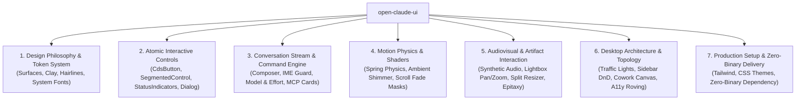

# Open Claude UI (`open-claude-ui`)

<p align="center">
  
</p>

<p align="center">
  <strong>Production-grade, clean-room reverse-engineered implementation of the Claude Design System (CDS) and interaction physics.</strong>
</p>

<p align="center">
  <a href="README.md">简体中文</a> · <strong>English</strong>
</p>

<p align="center">
  <a href="https://github.com/Caho1/open-claude-ui/stargazers"></a>
  <a href="LICENSE"></a>
  <a href="https://github.com/morluto/rea"></a>
  <a href="assets/README.md"></a>
  <a href="https://www.typescriptlang.org/"></a>
  <a href="https://react.dev/"></a>
  <a href="https://tailwindcss.com/"></a>
  <a href="https://www.framer.com/motion/"></a>
</p>

---

## 📖 Introduction

`open-claude-ui` is a high-fidelity open-source UI component library and motion physics engine, built from an in-depth clean-room teardown of the **Claude Desktop 2.42304.0.0** package (Windows MSIX `Claude_2.42304.0.0_x64__pzs8sxrjxfjjc`) and runtime measurements of the **claude.ai** web app.

All reverse derivation, de-obfuscation static analysis, and ASAR package deconstruction were conducted using the multi-platform reverse engineering framework **[REA (Reverse Engineer Anything)](https://github.com/morluto/rea)**. Leveraging REA's static AST deconstruction, closure de-obfuscation, and runtime tracing capabilities, we penetrated production bundles to extract the underlying physical constants, interaction constraints, and mathematical models.

Every component specification, damping constant, shader keyframe, and audio pipeline in this project is derived from the 2.42304.0.0 package sources and claude.ai measurements:
* **Restrained Editorial Warmth**: Neutral black / white primary buttons, Clay (`--cds-fill-brand` `#c6613f`) reserved for the send key and Spark, a cool surface ladder (surface-0 `#f9f9f7` / surface-1 `#fcfcfb`, dark `#0b0b0b` / `#151515`), and Retina hairline compensation;
* **Rigorous Interaction Physics**: 4 spring physics presets, 4px pointer movement deadzones, CJK IME composition guards, and 7-stop non-linear alpha fade masks;
* **Audiovisual & Desktop Architecture**: Zero-latency procedural audio synthesis via Web Audio API oscillators, cursor-anchored gallery pan/zoom, macOS traffic-light zoom compensation, and Cowork multi-agent orchestration topologies.

> ⚖️ **Copyright & Asset Compliance (DMCA & Assets Policy)**:  
> This open-source repository **does not distribute any proprietary binary assets** (including commercial `.ttf` fonts and recorded `.mp3` audio). We provide native system font fallback stacks and procedural Web Audio synthesis algorithms, ensuring a completely self-contained, legal, and clean-room compliant codebase. For details, see [assets/README.md](assets/README.md).

---

## 🌟 Key Features



1. **33 Independent Code Modules**: React components, Hooks, and an Electron main-window factory, plus the global theme stylesheet and Tailwind config. Copy-paste ready with zero black-box dependencies.
2. **Native System Typography & Procedural Audio**: Engineered system font fallback stacks and zero-latency Web Audio oscillator synthesis engines.
3. **Interactive Storybook Preview**: A single-file offline storybook with component chapters 01–09 and the claude.ai web measurement page (W0–W15).
4. **Reverse Engineering Report**: Six chapters in [`docs/v2/`](docs/v2/README.md) (Simplified Chinese), plus a [merged full text](docs/v2/Claude-Desktop-2.42304.0.0-全量分析.full.md).

---

## 📚 Technical Report

Everything is based on the Claude Desktop 2.42304.0.0 package and claude.ai runtime measurements. See [`docs/README.md`](docs/README.md) for the index:

* **[Chapter 1: Overview & Version Boundary](docs/v2/01-综述与版本边界.md)**: Bundled CLI 2.1.299 and MSIX multi-process boundaries, how the desktop app loads the web app, the Clay restraint rule, and the human-voice serif boundary.
* **[Chapter 2: Core Features](docs/v2/02-核心特性逆向.md)**: Popout windows and window-level find-in-page, the Cowork artifact library allowlist, queued messages, 5 effort levels, FloatingComposer tri-state morphing, `.urm` quota-ring heartbeat, Oklab gloss sheet cards, 5-font optical hanging punctuation, and SableOtter HUD / CuTeach / CuWatchRecord / Hardware Buddy / ClawdQuest.
* **[Chapter 3: UI Architecture & Style System](docs/v2/03-界面架构与样式系统.md)**: Canvas colors, compact / comfortable radius and density, pill and skeleton micro-interactions, chapter pins, and the Tailwind v4 `@layer cds-card` architecture.
* **[Chapter 4: System Foundations](docs/v2/04-系统底座全景解密.md)**: 152 pure-CSS keyframes, 52 `data-cds` component namespaces, 5 duration tokens, the official 6-layer token model, and the Cove 8-color data-visualization palette.
* **[Chapter 5: Reference Implementations](docs/v2/05-生产级参考实现代码.md)**: `ModelSelectorEffort.tsx`, `ChatComposerChin.tsx`, `CdsMotionEngine.tsx`.
* **[Chapter 6: Summary](docs/v2/06-总结.md)**: Structural standardization, physics-driven motion, and desktop-native integration.
* **[claude.ai Web Measurements](docs/claude-components-storybook.html#claude-ai-web)**: Shell coordinates, sidebar, composer, menus, message stream, button anatomy, icon font, motion durations, tokens, login page, hidden mechanisms, Code session lineage, and thinking state machine (W0–W14, with web and desktop shown side by side wherever they behave differently), plus desktop-only features (W15).

---

## 🔬 Decompiled Algorithms & Engineering Physics

UI components are just the surface. **What makes the Claude interaction feel unique are the physical equations and mathematical models buried inside the obfuscated code.** Each of the 8 algorithms below was traced to its source in the 2.42304.0.0 package:

### 1. 7-Stop Non-Linear Alpha Gradient Fade Mask
* **Pain Point**: Standard two-color linear scroll masks cause color banding and harsh cut-offs on high-DPI displays.
* **Claude's Algorithm**: Within the feather distance (`--cds-scroll-fade-size`, 28px), Claude samples a 7-stop non-linear ladder (Alpha 5.1% `#0d` at 15%, 14.9% `#26` at 30%, 30.2% `#4d` at 45%, 50.2% `#80` at 60%, 70.2% `#b3` at 75%, 85.1% `#d9` at 87%, closely following $y \approx x^{1.5}$). The feather on a side collapses to zero when scrolled to that edge:
```css
/* Extracted from c6a992d55-sXiDGMFQ.css */
mask-image: linear-gradient(to bottom,
  transparent,
  #0000000d calc(var(--cds-scroll-fade-top) * .15),
  #00000026 calc(var(--cds-scroll-fade-top) * .3),
  #0000004d calc(var(--cds-scroll-fade-top) * .45),
  #00000080 calc(var(--cds-scroll-fade-top) * .6),
  #000000b3 calc(var(--cds-scroll-fade-top) * .75),
  #000000d9 calc(var(--cds-scroll-fade-top) * .87),
  #000 var(--cds-scroll-fade-top),
  #000 calc(100% - var(--cds-scroll-fade-bottom)),
  #000000d9 calc(100% - var(--cds-scroll-fade-bottom) * .87),
  #000000b3 calc(100% - var(--cds-scroll-fade-bottom) * .75),
  #00000080 calc(100% - var(--cds-scroll-fade-bottom) * .6),
  #0000004d calc(100% - var(--cds-scroll-fade-bottom) * .45),
  #00000026 calc(100% - var(--cds-scroll-fade-bottom) * .3),
  #0000000d calc(100% - var(--cds-scroll-fade-bottom) * .15),
  transparent
);
```

### 2. Microphone 8% Noise Floor Gating & Gamma 0.7 Compression
* **Pain Point**: Mapping raw energy to bar height makes ambient noise jitter constantly and loud input clip.
* **Claude's Algorithm** (`LiveMicActivityBars`, `c4a1e6da6-OklNVuRg.js`): average energy per frequency band, subtract the noise floor (default `.08`), renormalize, then apply a 0.7 power curve, 1.5× gain, and a per-band weight $W_b$:
$$\text{Compressed} = \min\left(1, \left(\frac{\max(0, E - 0.08)}{0.92}\right)^{0.7} \times 1.5 \times W_b\right)$$
Soft speech is gently amplified while loud peaks are naturally tamed.

### 3. CJK IME Composition Double-Interlock Guard
* **Pain Point**: CJK users pressing Enter / Escape to confirm or dismiss IME candidates accidentally send messages or close UI.
* **Claude's Algorithm**: Key handlers first check `e.isComposing || e.keyCode === 229`; the stray Enter that WebKit dispatches right after `compositionend` is caught by `Math.abs(e.timeStamp - compositionEndAt) < 500` (both in `shared-frame-BfjMqbuN.js`). The Escape-to-cancel handler of pane dragging carries the same guard (`shared-22-HztmyUTM.js`).

### 4. 150ms Scroll Pinning Cooldown
* **Pain Point**: While tokens stream in, users scrolling up to read history get yanked back to the bottom.
* **Claude's Algorithm** (`ca2ef848d-CWUk7Rll.js`): follow-to-bottom only runs when `performance.now() - getLastUserInputAt() > 150`; programmatic scrolls call `markProgrammaticScroll()` first and then align instantly with `behavior: "auto"`, so they are never mistaken for user input.

### 5. Cursor-Anchored Affine Pan/Zoom Equation
* **Pain Point**: Standard galleries zoom around the viewport center, pushing the detail under the cursor off-screen.
* **Claude's Algorithm** (`c4b054ed5-C43deEXI.js`): treat the cursor $(O_x, O_y)$ (relative to the fit center) as the fixed point:
$$\text{idealTx}' = O_x - (O_x - \text{idealTx}) \cdot \frac{S_{\text{target}}}{S_{\text{current}}}$$
The result is clamped to `maxTx`; wheel zoom uses `Math.exp(-deltaY * 0.01)`, and dragging has a `Math.hypot(dx, dy) < 4` deadzone.

### 6. macOS Traffic Light Zoom Compensation
* **Pain Point**: When web content scales with `zoomFactor`, the native traffic lights drift off the title bar's center line.
* **Claude's Algorithm**: The main process (`.vite/build/index.chunk-lzaSYO3Q.js`) uses a 12px button diameter and a `33 / 2` baseline to compute `Math.max(0, Math.round((16.5 + 6) * zoom - 6))` for `setWindowButtonPosition`; the renderer (`shared-10-THQui8pC.js`) reserves `Math.round(74 / Math.min(zoom, 1))` px, dropping to zero in fullscreen; windowed corners use `setBorderRadius(isMaximized || isFullScreen ? 0 : 8)`.

### 7. Shadow DOM Isolation + CSS Grid Line-Height Geometric Hard-Lock
* **Pain Point**: With word wrap on, line numbers and code drift out of alignment in diff viewers.
* **Claude's Algorithm** (`c19e90103-muBq-gyt.js`): the diff view lives in `attachShadow({ mode: "open" })` for style isolation; gutter and code columns both receive `gridRow = span ${lines}`, so one grid locks both row heights.

### 8. Iframe Pointer Event Shield (Pane Drag Shield)
* **Pain Point**: Dragging a split divider over an embedded iframe lets the iframe swallow pointer events and freeze the drag.
* **Claude's Algorithm**: Dragging writes `data-pane-dragging` on the host (`shared-22-HztmyUTM.js`, Escape cancels and rolls back), and the stylesheet applies `pointer-events: none` to `.dframe-pane-host[data-pane-dragging] iframe` (`shared-styles-Bl9zqrv-.css`).

---

## 📂 Repository Structure

```
open-claude-ui/
├── assets/                           # Asset guidelines & compliance
│   ├── images/logo.svg               # Open source vector logo
│   └── README.md                     # Asset compliance & system fallback stacks
├── code-examples/                    # 33 independent code modules + theme stylesheet & Tailwind config
│   ├── ArtifactsSplitPaneResizer.tsx # Elastic split pane & collapse engine
│   ├── AttachmentCard.tsx            # Attachment tiles & context pills
│   ├── cds-theme.css                 # Global theme stylesheet (CSS variables & keyframes)
│   ├── CdsButton.tsx                 # Button size ladder & variants
│   ├── CdsMotionEngine.tsx           # sibling-index / View Transitions / scroll-driven motion demo
│   ├── ChatComposer.tsx              # Core composer terminal
│   ├── ChatComposerChin.tsx          # Composer chin & effort entry point
│   ├── ChatMessageBubbles.tsx        # Message bubbles (User & Assistant)
│   ├── ClaudeAudioPlayer.ts          # Low-latency audio engine (Web Audio synthesis)
│   ├── ClaudeDesktopHeader.tsx       # Immersive macOS title bar
│   ├── ClaudeMotionPresets.ts        # Motion engine & damped harmonic oscillator solver
│   ├── CodeBlock.tsx                 # Code block & 2.5s copy decay state machine
│   ├── ConfirmationDialog.tsx        # Modal confirmation dialog
│   ├── ContainerResponsiveBar.tsx    # Container query responsive bar
│   ├── CoworkAgentCanvas.tsx         # Multi-agent orchestration board
│   ├── createClaudeMainWindow.ts     # Electron host main window factory
│   ├── DraggableSessionList.tsx      # Sidebar session drag-and-drop & pinning
│   ├── EpitaxyIframeBridge.tsx       # Artifacts preview sandbox bridge
│   ├── LiveMicActivityBars.tsx       # 6-bar mic waveform (noise floor + gamma)
│   ├── McpToolDecisionCard.tsx       # MCP tool call decision card
│   ├── MediaLightboxViewer.tsx       # Multimodal media lightbox & gallery runway
│   ├── ModelSelectorEffort.tsx       # Model selector with 5 effort levels
│   ├── ModelSwitcherWithTokenGauge.tsx # Model matrix switcher with token gauge
│   ├── ReasoningAmbientGlow.tsx      # Ambient reasoning glow effects
│   ├── RichComposerWithMentions.tsx  # Composer with IME guard and / & @ triggers
│   ├── ScrollFadeContainer.tsx       # 7-stop non-linear alpha fade mask
│   ├── SegmentedControl.tsx          # Segmented control (control-radius track + sliding indicator)
│   ├── StatusIndicators.tsx          # Clay breathing dots, pulses & skeleton shimmer
│   ├── StreamingDiffViewer.tsx       # Streaming diff viewer & highlighter
│   ├── tailwind.config.js            # Tailwind config extension
│   ├── ThinkingAccordion.tsx         # Thinking process state machine accordion
│   ├── useClaudeRovingFocus.ts       # Keyboard roving focus Hook
│   ├── useClaudeScrollPinning.ts     # Streaming scroll pinning Hook
│   ├── useClaudeSharedElementTransition.ts # View Transitions shared element Hook
│   └── useRateLimitBackoff.ts        # 429/503 exponential backoff Hook
├── docs/
│   ├── README.md                     # Documentation index
│   ├── v2/                           # Claude Desktop 2.42304.0.0 report (6 chapters + merged text)
│   └── claude-components-storybook.html # Interactive storybook (double-click to open offline)
├── src/
│   └── index.ts                      # Unified TypeScript library entry point
├── package.json
├── tsconfig.json
└── README.md
```

---

## 🚀 Quick Start

### 1. Import Stylesheet & Tailwind Extension

Import the CDS core theme stylesheet into your project:
```css
/* Import global theme variables and keyframes */
@import "open-claude-ui/code-examples/cds-theme.css";
```

Extend your `tailwind.config.js`:
```javascript
const cdsTheme = require("open-claude-ui/code-examples/tailwind.config.js");

module.exports = {
  content: [
    "./src/**/*.{js,ts,jsx,tsx}",
    "./node_modules/open-claude-ui/**/*.{js,ts,jsx,tsx}"
  ],
  theme: {
    extend: {
      ...cdsTheme.theme.extend
    }
  }
};
```

### 2. Using Core Components

```tsx
import React from 'react';
import {
  ChatComposer,
  ModelSwitcherWithTokenGauge,
  ScrollFadeContainer
} from 'open-claude-ui';

export function App() {
  return (
    <div className="flex h-screen w-full bg-[var(--cds-surface-1)]">
      <ScrollFadeContainer orientation="vertical" fadeSize={28} className="flex-1 p-6">
        <div className="mx-auto max-w-3xl space-y-4">
          <ModelSwitcherWithTokenGauge
            currentModelId="claude-opus-5-5"
            onSelectModel={(model) => console.log('Model:', model.name)}
            tokenMetrics={{
              inputTokens: 12400,
              outputTokens: 3200,
              cacheReadTokens: 48000,
              cacheWriteTokens: 16000,
              cacheTtl: '5m'
            }}
          />
          <ChatComposer onSendMessage={(text) => console.log('Send message:', text)} />
        </div>
      </ScrollFadeContainer>
    </div>
  );
}
```

---

## 🎨 Interactive Storybook Preview

No need to spin up a heavy local development server—simply double-click the bundled standalone HTML file to experience the complete suite of high-fidelity components:
```bash
open docs/claude-components-storybook.html
```

The storybook includes:
* Component chapters 01–09: foundations, app shell, chat & composer, controls, code & artifacts, overlays, motion, border philosophy, and v2.42304.0 design aesthetics
* The claude.ai web measurement page (W0–W15): coordinates, tokens, menus, motion durations, web and desktop side by side, and desktop-only features
* Real-time Dark Mode switching and second-order spring motion demos

---

## 🤖 AI Agent Guidelines & Development Standards

This repository includes first-class development specifications tailored for modern AI Coding Agents (such as Cursor, Windsurf, Claude Code, GitHub Copilot, Devin, Antigravity, etc.):

* **Universal Agent Guidelines**: [`AGENTS.md`](AGENTS.md) (Loaded automatically in repository root, covering semantic design tokens, the 4-tier spring preset matrix, single-stroke border discipline, IME guards, and verification gates).
* **Claude Code Instructions**: [`CLAUDE.md`](CLAUDE.md) (Dedicated CLI commands and conventions for Anthropic's Claude Code toolchain).
* **IDE Agent Rules**: [`.cursorrules`](.cursorrules) and [`.github/copilot-instructions.md`](.github/copilot-instructions.md).

> 💡 **Tip for developers using AI assistants**:  
> When prompting Cursor / Claude Code / Copilot to implement frontend UI or animations for your application, simply instruct:  
> *"Strictly adhere to the AGENTS.md specification in this repository, using CDS Clay design tokens and ClaudeMotionPresets physics."*

---

## 🙏 Acknowledgements

* Special thanks to the open-source reverse engineering framework **[REA (Reverse Engineer Anything)](https://github.com/morluto/rea)** for providing the AST deconstruction, Electron runtime analysis, and engineering constant decompilation toolchain that made this project possible.
* Deep appreciation to the Anthropic design and front-end engineering teams for crafting an editorial-grade interaction system and meticulous engineering details that inspired this clean-room study.

---

## 📜 License

Distributed under the [MIT License](LICENSE). All decompiled research findings and code reproductions are intended solely for educational, research, and engineering exchange purposes.

---

## 📈 Star History

<div align="center">

[](https://star-history.com/#Caho1/open-claude-ui&Date)

</div>
