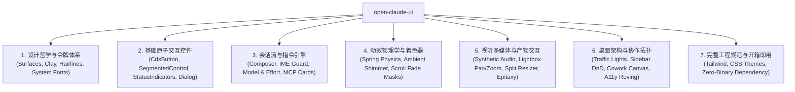

# Open Claude UI (`open-claude-ui`)

<p align="center">
  
</p>

<p align="center">
  <strong>基于 REA 深度拆解，高保真生产级还原 Claude 设计系统 (CDS) 与工程交互物理学。</strong>
</p>

<p align="center">
  <strong>简体中文</strong> · <a href="README-en.md">English</a>
</p>

<p align="center">
  <a href="https://github.com/Caho1/open-claude-ui/stargazers"></a>
  <a href="LICENSE"></a>
  <a href="https://github.com/morluto/rea"></a>
  <a href="assets/README.md"></a>
  <a href="https://www.typescriptlang.org/"></a>
  <a href="https://react.dev/"></a>
  <a href="https://tailwindcss.com/"></a>
  <a href="https://www.framer.com/motion/"></a>
</p>

---

## 📖 简介 (Introduction)

`open-claude-ui` 是基于对 **Claude Desktop 2.42304.0.0**（Windows MSIX `Claude_2.42304.0.0_x64__pzs8sxrjxfjjc`）安装包与 **claude.ai 网页版**运行时的深度拆解构建的高保真开源 UI 组件库与动效引擎。

整个逆向推导、反混淆静态分析与 ASAR 资源解构，均依托于多平台逆向工程框架 **[REA (Reverse Engineer Anything)](https://github.com/morluto/rea)** 完成——通过 REA 的静态 AST 解析、闭包代码反混淆与运行时跟踪能力，穿透生产级压缩包，精准还原了底层工程物理常数与数学模型。

本项目的组件规范、物理常数、着色器关键帧与音频管道均依据 2.42304.0.0 安装包源码与 claude.ai 实测提炼：
* **克制的人文质感 (Editorial Warmth)**：中性黑白主按钮、陶土色（`--cds-fill-brand` `#c6613f`）只留给发送键与 Spark、冷调表面阶梯（surface-0 `#f9f9f7` / surface-1 `#fcfcfb`，深色 `#0b0b0b` / `#151515`）与高分屏发丝细边补偿；
* **严苛的交互物理学 (Interaction Physics)**：4 套物理弹簧预设、4px 指针移动死区、CJK 输入法合成守卫、7 档非线性 Alpha 渐隐遮罩；
* **高阶视听与系统架构 (Audiovisual & Architecture)**：基于原生 Web Audio API 的零延迟合成提示音、以光标为锚点的画廊平移缩放、macOS 红绿灯逆缩放补偿与 Cowork 多代理协同拓扑。

> ⚖️ **版权与合规声明 (DMCA & Assets Policy)**：
> 本开源项目**不公开分发任何专有二进制资产**（包括商业字体 `.ttf` 与录音 `.mp3`）。本项目提供原生系统级字体回退栈与 Web Audio API 纯代码合成音效，完全自包含、合规安全。详情参见 [assets/README.md](assets/README.md)。

---

## 🌟 核心特性 (Key Features)



1. **33 个独立代码模块**：React 组件、Hooks 与 Electron 主窗口工厂，另附全局主题样式表与 Tailwind 配置，即拷即用，零黑盒依赖。
2. **纯原生系统级排版与音效**：支持系统高保真字体回退栈，内置基于 Web Audio 振荡器的零延迟提示音合成引擎。
3. **交互式组件故事书 (Storybook Preview)**：单文件离线 Storybook，含 01–09 组件库章节与 claude.ai 网页版实测页（W0–W22）；其中 W16–W22 把安装包里全部可视化效果过了一遍，包括要特定条件才出现的效果。
4. **逆向分析报告**：[`docs/v2/`](docs/v2/README.md) 7 章，另有[合并全文](docs/v2/Claude-Desktop-2.42304.0.0-全量分析.full.md)。

---

## 📚 逆向分析报告 (Technical Report)

全部内容基于 Claude Desktop 2.42304.0.0 安装包与 claude.ai 网页版运行时实测，目录见 [`docs/README.md`](docs/README.md)：

* **[第 1 章：综述与版本边界](docs/v2/01-综述与版本边界.md)**：捆绑 CLI 2.1.299 与 MSIX 多进程边界、桌面版与网页版的加载关系、陶土品牌色克制守则与人声衬线分界。
* **[第 2 章：核心特性逆向](docs/v2/02-核心特性逆向.md)**：弹出窗口与窗口级页面搜索、Cowork 产物库白名单、排队消息、5 档努力程度、FloatingComposer 三态变形、`.urm` 环形配额心跳、Oklab 光泽折页卡片、5 字体光学悬挂标点及 SableOtter HUD / CuTeach / CuWatchRecord / Hardware Buddy / ClawdQuest。
* **[第 3 章：界面架构与样式系统](docs/v2/03-界面架构与样式系统.md)**：画布底色、compact / comfortable 圆角与密度系统、胶囊与骨架屏微交互、章节标记与 Tailwind v4 `@layer cds-card` 架构。
* **[第 4 章：系统底座全景解密](docs/v2/04-系统底座全景解密.md)**：全包 309 个关键帧（主样式表 152 个）、52 个 `data-cds` 组件命名空间、5 阶时间 Token、官方 6 层令牌架构与 Cove 8 色数据可视化色板。
* **[第 5 章：生产级参考实现代码](docs/v2/05-生产级参考实现代码.md)**：`ModelSelectorEffort.tsx`、`ChatComposerChin.tsx`、`CdsMotionEngine.tsx`。
* **[第 6 章：总结](docs/v2/06-总结.md)**：结构规范化、动效物理化与桌面原生化。
* **[第 7 章：隐藏与条件触发效果](docs/v2/07-隐藏与条件触发效果.md)**：309 个关键帧与 153 项非关键帧效果的盘点口径、需要特定条件才出现的效果、代码在但走不到的路径、减少动效与强制颜色，以及对既有数值的更正。
* **[claude.ai 网页版实测页](docs/claude-components-storybook.html#claude-ai-web)**：外壳坐标、侧栏、输入框、菜单、消息流、按钮解剖、图标字体、动效时长、令牌、登录页、隐藏机制、Code 会话族谱与思考状态机（W0–W14，两端行为不同的项网页与桌面就地并排）、桌面端独有功能（W15），以及安装包全部可视化效果的盘点与复刻（W16–W22）。

---

## 🔬 逆向解密的 8 大硬核算法与工程物理学 (Decompiled Algorithms & Physics)

UI 组件只是外壳，**真正让 Claude 交互质感脱颖而出的是隐藏在混淆代码底部的物理学方程与数学模型**。以下 8 项均在 2.42304.0.0 安装包中逐条核对过出处：

### 1. 7 档渐隐非线性透明度遮罩 (7-Stop Non-Linear Fade Mask)
* **痛点**：常规双色线性滚动遮罩在高分屏上存在色阶断层（Color Banding）与生硬切断感。
* **Claude 算法**：在羽化距离（`--cds-scroll-fade-size`，28px）内采用 7 档非线性采样阶梯（15% 处 Alpha 5.1% `#0d`、30% 处 14.9% `#26`、45% 处 30.2% `#4d`、60% 处 50.2% `#80`、75% 处 70.2% `#b3`、87% 处 85.1% `#d9`，曲线贴合 $y \approx x^{1.5}$），触顶 / 触底时对应一侧的羽化距离归零：
```css
/* 提取自 c6a992d55-sXiDGMFQ.css */
mask-image: linear-gradient(to bottom,
  transparent,
  #0000000d calc(var(--cds-scroll-fade-top) * .15),
  #00000026 calc(var(--cds-scroll-fade-top) * .3),
  #0000004d calc(var(--cds-scroll-fade-top) * .45),
  #00000080 calc(var(--cds-scroll-fade-top) * .6),
  #000000b3 calc(var(--cds-scroll-fade-top) * .75),
  #000000d9 calc(var(--cds-scroll-fade-top) * .87),
  #000 var(--cds-scroll-fade-top),
  #000 calc(100% - var(--cds-scroll-fade-bottom)),
  #000000d9 calc(100% - var(--cds-scroll-fade-bottom) * .87),
  #000000b3 calc(100% - var(--cds-scroll-fade-bottom) * .75),
  #00000080 calc(100% - var(--cds-scroll-fade-bottom) * .6),
  #0000004d calc(100% - var(--cds-scroll-fade-bottom) * .45),
  #00000026 calc(100% - var(--cds-scroll-fade-bottom) * .3),
  #0000000d calc(100% - var(--cds-scroll-fade-bottom) * .15),
  transparent
);
```

### 2. 麦克风 8% 底噪门限与 0.7 次幂 Gamma 压缩 (Noise Floor Gating & Gamma Compression)
* **痛点**：直接把能量映射为波形高度，会让环境底噪引起持续微抖、高分贝时爆格。
* **Claude 算法**（`LiveMicActivityBars`，`c4a1e6da6-OklNVuRg.js`）：按频带求平均能量，先减去底噪门限（默认 `.08`）再归一，叠加 0.7 次幂压缩、1.5 倍增益与频带权重 $W_b$：
$$\text{Compressed} = \min\left(1, \left(\frac{\max(0, E - 0.08)}{0.92}\right)^{0.7} \times 1.5 \times W_b\right)$$
微弱人声被温和放大，高分贝被自然平抑。

### 3. CJK 输入法合成双重互锁守卫 (IME Composition Guard)
* **痛点**：中日韩用户在候选词浮层敲 Enter / Escape 确认或关闭候选时，消息被误发送或界面被误关闭。
* **Claude 算法**：按键处理先判 `e.isComposing || e.keyCode === 229`；WebKit 在 `compositionend` 之后补发的 Enter 再由 `Math.abs(e.timeStamp - compositionEndAt) < 500` 拦截（均见 `shared-frame-BfjMqbuN.js`）。拖拽面板的 Escape 取消逻辑同样带这道守卫（`shared-22-HztmyUTM.js`）。

### 4. 150ms 冷却时间戳防抢夺视口图钉 (Scroll Pinning Cooldown)
* **痛点**：流式 Token 生成时，用户向上滚动查阅历史消息，会被新内容强制拉回底部。
* **Claude 算法**（`ca2ef848d-CWUk7Rll.js`）：只有 `performance.now() - getLastUserInputAt() > 150` 时才执行跟随；程序滚动先 `markProgrammaticScroll()` 再以 `behavior: "auto"` 瞬时对齐，避免被误判为用户输入。

### 5. 以鼠标光标为物理不动点的仿射 Pan/Zoom 方程
* **痛点**：普通画廊放大图片时以视口中心为原点，鼠标想查看的细节区域被推离屏幕。
* **Claude 算法**（`c4b054ed5-C43deEXI.js`）：把光标 $(O_x, O_y)$（相对适配中心）视为不动点：
$$\text{idealTx}' = O_x - (O_x - \text{idealTx}) \cdot \frac{S_{\text{target}}}{S_{\text{current}}}$$
结果再按 `maxTx` 钳制；滚轮缩放系数为 `Math.exp(-deltaY * 0.01)`，拖拽以 `Math.hypot(dx, dy) < 4` 作为死区。

### 6. macOS 红绿灯逆缩放补偿 (Traffic Light Zoom Compensation)
* **痛点**：网页内容随 `zoomFactor` 缩放后，原生红绿灯与标题栏内容的中心线会错位。
* **Claude 算法**：主进程（`.vite/build/index.chunk-lzaSYO3Q.js`）以按钮直径 12、基准线 `33 / 2` 计算 `Math.max(0, Math.round((16.5 + 6) * zoom - 6))` 并调用 `setWindowButtonPosition`；渲染端（`shared-10-THQui8pC.js`）的占位宽度为 `Math.round(74 / Math.min(zoom, 1))`，全屏时归零；窗口化圆角为 `setBorderRadius(isMaximized || isFullScreen ? 0 : 8)`。

### 7. Shadow DOM 隔离 + CSS Grid 行高几何硬锁
* **痛点**：代码差异对比在长行换行（Word Wrap）时，行号与代码经常错位。
* **Claude 算法**（`c19e90103-muBq-gyt.js`）：差异视图挂在 `attachShadow({ mode: "open" })` 里隔离样式；行号栏与代码栏在 CSS Grid 中同步写入 `gridRow = span ${lines}`，两栏行高被同一网格锁定。

### 8. Iframe 事件防吞噬护盾 (Pane Drag Shield)
* **痛点**：拖拽分栏时指针划过内嵌 iframe，iframe 截获事件导致拖拽卡死。
* **Claude 算法**：拖拽开始时在宿主节点写入 `data-pane-dragging`（`shared-22-HztmyUTM.js`，Escape 可取消并回滚），样式表随即对 `.dframe-pane-host[data-pane-dragging] iframe` 施加 `pointer-events: none`（`shared-styles-Bl9zqrv-.css`）。

---

## 📂 项目结构 (Repository Structure)

```
open-claude-ui/
├── assets/                           # 资产说明与合规指引
│   ├── images/logo.svg               # 开源矢量标识
│   └── README.md                     # 资产合规与系统级回退栈说明
├── code-examples/                    # 33 个独立代码模块 + 主题样式表与 Tailwind 配置
│   ├── ArtifactsSplitPaneResizer.tsx # 双栏弹性分割与折叠引擎
│   ├── AttachmentCard.tsx            # 附件磁贴与上下文胶囊
│   ├── cds-theme.css                 # 全局主题样式表 (CSS 自定义属性与 Keyframes)
│   ├── CdsButton.tsx                 # 按钮尺寸阶梯与变体
│   ├── CdsMotionEngine.tsx           # sibling-index / View Transitions / Scroll-Driven 动效演示
│   ├── ChatComposer.tsx              # 核心输入框终端
│   ├── ChatComposerChin.tsx          # 输入框底部 Chin 与努力程度入口
│   ├── ChatMessageBubbles.tsx        # 会话气泡套件 (User & Assistant)
│   ├── ClaudeAudioPlayer.ts          # 低延迟音频引擎 (内置 Web Audio 原生合成振荡器)
│   ├── ClaudeDesktopHeader.tsx       # macOS 沉浸式标题栏组件
│   ├── ClaudeMotionPresets.ts        # 动效引擎与二阶阻尼谐振子数学求解
│   ├── CodeBlock.tsx                 # 代码块容器与 2.5s 复制衰减状态机
│   ├── ConfirmationDialog.tsx        # 模态确认对话框
│   ├── ContainerResponsiveBar.tsx    # 自适应容器查询响应栏
│   ├── CoworkAgentCanvas.tsx         # 多智能体协同看板与拓扑空间
│   ├── createClaudeMainWindow.ts     # Electron 宿主主窗口创建工厂
│   ├── DraggableSessionList.tsx      # 侧边栏会话拖放与固定物理
│   ├── EpitaxyIframeBridge.tsx       # Artifacts 预览沙箱桥接器
│   ├── LiveMicActivityBars.tsx       # 6 柱麦克风波形（底噪门限 + Gamma 压缩）
│   ├── McpToolDecisionCard.tsx       # MCP 交互式工具调用决策卡片
│   ├── MediaLightboxViewer.tsx       # 多模态媒体查看器与画廊跑道
│   ├── ModelSelectorEffort.tsx       # 模型选择器与 5 档努力程度
│   ├── ModelSwitcherWithTokenGauge.tsx # 模型矩阵选择器与 Token 仪表盘
│   ├── ReasoningAmbientGlow.tsx      # 动态光效与推理氛围感组件
│   ├── RichComposerWithMentions.tsx  # CJK 守卫、/ 与 @ 双触发符输入终端
│   ├── ScrollFadeContainer.tsx       # 7 档非线性 Alpha 渐变遮罩
│   ├── SegmentedControl.tsx          # 分段选择器（控件圆角轨道 + 滑动指示器）
│   ├── StatusIndicators.tsx          # 陶土呼吸灯、运行脉冲与骨架屏扫光
│   ├── StreamingDiffViewer.tsx       # 代码差异对比与流式高亮引擎
│   ├── tailwind.config.js            # Tailwind 配置工程扩展
│   ├── ThinkingAccordion.tsx         # 思考过程状态机折叠组件
│   ├── useClaudeRovingFocus.ts       # 全键盘无障碍焦点漫游 Hook
│   ├── useClaudeScrollPinning.ts     # 流式滚动视口图钉 Hook
│   ├── useClaudeSharedElementTransition.ts # View Transitions 共享元素变形 Hook
│   └── useRateLimitBackoff.ts        # 429/503 指数退避与熔断状态机 Hook
├── docs/
│   ├── README.md                     # 文档目录
│   ├── v2/                           # Claude Desktop 2.42304.0.0 逆向分析报告（7 章 + 合并全文）
│   └── claude-components-storybook.html # 交互式可视化故事书 (双击即可离线体验)
├── src/
│   └── index.ts                      # 统一对外导出的 TypeScript 库入口
├── package.json
├── tsconfig.json
└── README.md
```

---

## 🚀 快速上手 (Quick Start)

### 1. 引入样式表与 Tailwind 配置

在你的项目中引入 CDS 核心主题样式表：
```css
/* 引入全局主题变量与关键帧 */
@import "open-claude-ui/code-examples/cds-theme.css";
```

在你的 `tailwind.config.js` 中扩展主题：
```javascript
const cdsTheme = require("open-claude-ui/code-examples/tailwind.config.js");

module.exports = {
  content: [
    "./src/**/*.{js,ts,jsx,tsx}",
    "./node_modules/open-claude-ui/**/*.{js,ts,jsx,tsx}"
  ],
  theme: {
    extend: {
      ...cdsTheme.theme.extend
    }
  }
};
```

### 2. 使用核心组件

```tsx
import React from 'react';
import {
  ChatComposer,
  ModelSwitcherWithTokenGauge,
  ScrollFadeContainer
} from 'open-claude-ui';

export function App() {
  return (
    <div className="flex h-screen w-full bg-[var(--cds-surface-1)]">
      <ScrollFadeContainer orientation="vertical" fadeSize={28} className="flex-1 p-6">
        <div className="mx-auto max-w-3xl space-y-4">
          <ModelSwitcherWithTokenGauge
            currentModelId="claude-opus-5-5"
            onSelectModel={(model) => console.log('Model:', model.name)}
            tokenMetrics={{
              inputTokens: 12400,
              outputTokens: 3200,
              cacheReadTokens: 48000,
              cacheWriteTokens: 16000,
              cacheTtl: '5m'
            }}
          />
          <ChatComposer onSendMessage={(text) => console.log('Send message:', text)} />
        </div>
      </ScrollFadeContainer>
    </div>
  );
}
```

---

## 🎨 视觉故事书预览 (Interactive Storybook)

无需启动繁重的本地服务器，只需双击打开自带的 HTML 文件即可体验全量高保真组件：
```bash
open docs/claude-components-storybook.html
```
故事书包含：
* 01–09 组件库章节：设计基石、应用框架、对话与输入、交互表单、代码与产物、弹窗与浮层、动效与物理、边界哲学、v2.42304.0 设计美学
* claude.ai 网页版实测页（W0–W22）：坐标、令牌、菜单、动效时长，网页与桌面并排，桌面端独有功能单列
* W16 关键帧全目录：309 个关键帧逐个写明功能、触发条件与证据，可点按重放；W17–W22 复刻要特定条件才出现的效果（电脑使用屏幕光晕、天气工具卡片、升级庆祝页、Imagine 可视化部件等）
* 深色模式即时切换与二阶弹簧动效实时演示

---

## 🤖 AI Agent 协同与开发规范 (Agent Guidelines)

本项目针对现代 AI Coding Agents（如 Cursor, Windsurf, Claude Code, GitHub Copilot, Devin, Antigravity 等）深度适配了前端 UI 与动效开发指引规范：

* **全局 Agent 规范指南**：[`AGENTS.md`](AGENTS.md)（根目录自动生效，包含设计令牌、物理弹簧选型矩阵、单闭合边框原则、输入法防御守卫与质量门禁）。
* **Claude Code 专用指引**：[`CLAUDE.md`](CLAUDE.md)（针对 Anthropic 官方 CLI 工具链的指令与开发约束）。
* **IDE Agent 规则**：[`.cursorrules`](.cursorrules) 与 [`.github/copilot-instructions.md`](.github/copilot-instructions.md)。

> 💡 **给使用 AI 助手的开发者提示**：
> 当你让 Cursor / Claude Code / Copilot 为你的产品实现前端页面或动效时，可直接向 Agent 提示：
> *“请严格遵循本仓库中的 AGENTS.md 规范，使用 CDS 陶土设计令牌与 ClaudeMotionPresets 弹簧预设构建当前组件。”*

---

## 🙏 致谢与逆向支持 (Acknowledgements)

* 特别鸣谢开源逆向框架 **[REA (Reverse Engineer Anything)](https://github.com/morluto/rea)** 为本项目提供的 AST 解密、Electron 运行时分析与工程常数反编译工具链支持。
* 致敬 Anthropic 设计与前端团队打造的人文级交互系统与工程细节，启发了本开源复现研究。

---

## 📜 许可证 (License)

本项目基于 [MIT License](LICENSE) 开源发布。所有反编译研究成果与代码复现仅供学习、研究与工程交流使用。

---

## 📈 Star History

<div align="center">

[](https://star-history.com/#Caho1/open-claude-ui&Date)

</div>
