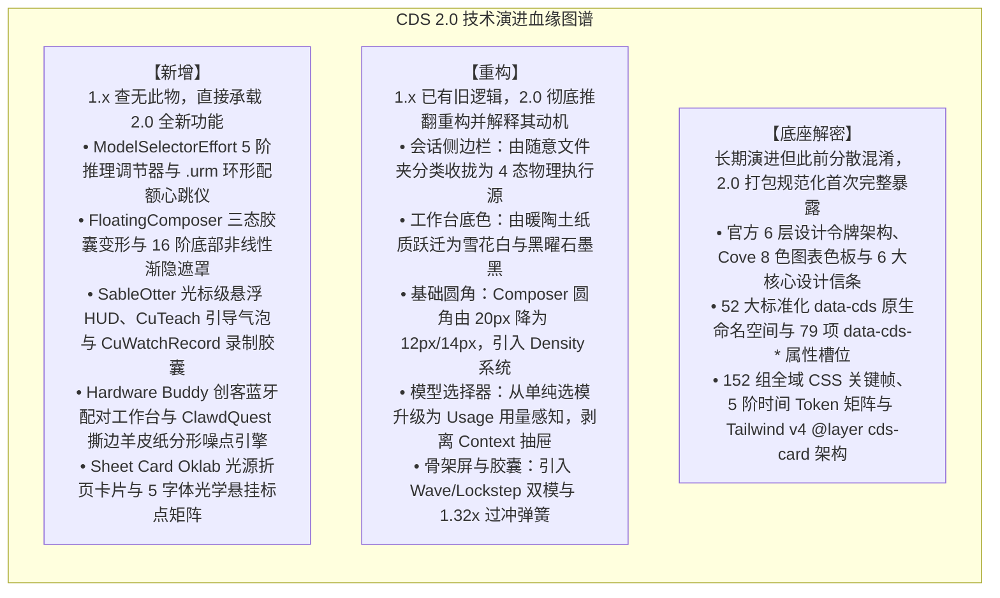

# 第一章：综述与版本边界

## 1. 综述

### 1.1 版本边界声明

在最新发布的 Claude 桌面端生产包中，软件版本已迭代至 **v2.42304.0**（`@ant/desktop@2.42304.0`，MSIX 包标识 `Claude_2.42304.0.0_x64__pzs8sxrjxfjjc`，Commit `e7f60e658f15cfece9efa384a78a39aec3c12845`，Build Timestamp `2026-10-15T05:54:05.000Z`）。

依托 REA 对该版本 `app.asar`（SHA-256: `8f4d3dec5e4f3ddffb150321060b18807d83a40f3a65618fe4f29325379da9db`，REA 证据 ID: `ev_db29cf6b5757fd86666fd272343cccd383bf391d00dac49aada8f2d616fa36c8`）及 `ion-dist/_frame-rt`（SHA-256: `bf7f0d4d90fe36017d28545260461bf654084e45b3abb4bb7e9a91d2acde81c0`，REA 证据 ID: `ev_22511fe4b0510120cb637aec50b4b588fa8a301da945139efa71bd25ad0e3587`）解包出的 `MainWindowPage-DTxMhyWF.css`、`c6a992d55-sXiDGMFQ.css`、`index.chunk-BYMGAPtw.js`（内嵌官方 `@ant/cds` 与 Imagine 规范）、`index.chunk-lzaSYO3Q.js` 以及 15 个 BrowserWindow 宿主入口的审查，我们确立了本篇报告的核心技术特征分类准则：

同时，我们明确划分桌面端包与命令行独立发布的边界：
* **桌面端捆绑版本**：在 v2.42304.0 中，桌面端内部捆绑的 Claude Code CLI 清单已升级至 **2.1.299**（Commit `c416f56ec7eca27e49747c35af51d5c92c856ba1`，`@anthropic-ai/claude-agent-sdk@0.3.299`），相比 v2.37337.1 捆绑的 2.1.295 完成了跨平台 `.zst` 镜像同步；
* **多进程宿主边界**：Windows MSIX 生产包除主程序 `app\Claude.exe` 外，随包集成了 `cowork-svc.exe`、`claude-ssh-broker.exe`、`claude-ssh-proxy.exe`、`claude-ssh-askpass.exe`、`chrome-native-host.exe` 与 `smol-bin.x64.vhdx` 虚拟化镜像。

---

### 1.2 全局设计契约演进

#### 1. 1.x 对话外壳 vs 2.0 执行沙箱工作站对比

| 核心维度 | CDS 1.x 规范基线 | CDS 2.0 架构升级 |
| :--- | :--- | :--- |
| **应用定位** | 单一窗口的“大模型流式对话外壳” | 具备本地 VM 隔离与多智能体分发的“开发工作站” |
| **执行载体隔离** | 模糊的本地文件夹绑定 | 严格区分 **本机 (This Computer) / Cloud / SSH / Slack** 四大物理执行源 |
| **多任务视图** | 单一主窗口，聊天与文件分屏挤压 | 支持独立的 **`PopoutWindow`（弹射窗口）**，多屏幕并行查看 |
| **离线自治能力** | 严重依赖公网 CDN 拉取渲染脚本 | **本地 ASAR 内置三大渲染引擎**，断网强可用 |
| **状态持久化** | 仅依赖内存状态，刷新即丢失未决输入 | **IndexedDB 离线重试账本**，刷新原位恢复 |

#### 2. 为什么 Anthropic 要重塑全局契约

1. **从“聊天机器人 (Chatbot)”向“自主智能体 (Autonomous Agent)”的范式转移**：
   在 1.x 时代，用户与 Claude 的交互以文本交谈、代码生成并手动复制为主。到了 2.0 时代，Claude Code CLI 与 Cowork 模式开始接管用户计算机的终端操作、文件自动读写与并行 Git 分支克隆。如果继续沿用旧有的“单窗口会话”模式，后台运行的自主任务会极易打断用户前台操作（例如吃键盘输入、抢焦点）。
2. **物理安全与沙箱权限的严格收敛**：
   旧版本按文件夹分类让用户误以为所有任务的执行边界是一样的。实际上，运行在本地轻量级 Linux 虚拟机、远端 Linux SSH 服务器与云端容器的任务，其破坏性、文件写入范围与安全边界完全不同。因此，2.0 强制将会话重构为按**物理源（Environment）**隔离，消除安全越界风险。

#### 3. 核心设计契约：环境不可变性与零丢失输入承诺

* **契约 1：环境在会话创建后不可变（Environment Immutability）**：
  在 2.0 中，会话一旦由 `NewSessionDrawer` 创建，其绑定的上下文窗口大小（Context Window）、Worktree 根目录及 MCP 扩展配置即刻被永久冻结，杜绝在长对话中途因修改环境导致的 Prompt Caching 失效与状态错乱。
* **契约 2：用户指令零丢失保证（Zero-loss Input Promise）**：
  不论是应用意外崩溃、网络瞬间闪断、触发 5 小时速率限制还是开发者主动刷新窗口，用户输入的工程指令必须被持久化在本地存储中，并具备确定性的原位重试机制。
* **契约 3：陶土品牌色克制守则与人声衬线分界（Clay Restraint & Serif Voice）**：
  从 `index.chunk-BYMGAPtw.js` 内嵌的 `@ant/cds` 官方规范（由 `apps/cds-docs/scripts/gen-cds-skill.mjs` 生成）中证实：Anthropic 明确确立了 **“Clay is Claude's color”** 与 **“Serif is Claude's voice”** 两大美学铁律——陶土色（`--fill-brand: #c6613f` / `--clay: #d97757`）严格保留给 **Claude 主动发起的动作**（如发送、生成、Spark 徽标与实时听写波形），普通用户主操作按钮一律使用中性主色（`--fill-primary`）或蓝色强调色（`--fill-accent`）；Claude 的回复正文与高光数据采用衬线体（`--font-voice` / `Anthropic Serif`），而外围应用壳层（Chrome）保持无衬线体（`--font-sans` / `Anthropic Sans`），使读者在阅读第一个词之前即可由字体感知说话者身份。

---
