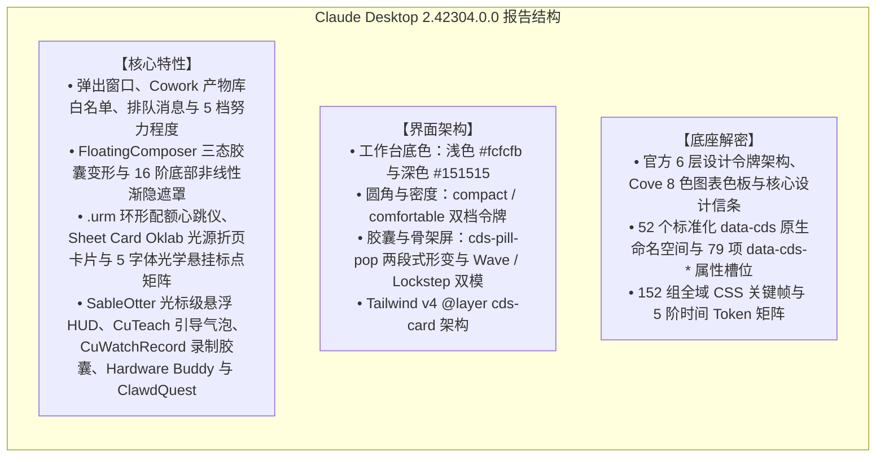

# 第一章：综述与版本边界

## 1. 综述

### 1.1 版本边界声明

本报告的分析对象是 Claude 桌面端生产包 **v2.42304.0**（`@ant/desktop@2.42304.0`，MSIX 包标识 `Claude_2.42304.0.0_x64__pzs8sxrjxfjjc`，Commit `e7f60e658f15cfece9efa384a78a39aec3c12845`，Commit Timestamp `2026-10-15T05:54:05.000Z`，随包 ion-dist 构建时间戳 `1792044185`（2026-10-15T06:03:05Z））。

依托 REA 对该版本 `app.asar`（SHA-256: `8f4d3dec5e4f3ddffb150321060b18807d83a40f3a65618fe4f29325379da9db`，REA 证据 ID: `ev_db29cf6b5757fd86666fd272343cccd383bf391d00dac49aada8f2d616fa36c8`）及 `ion-dist/_frame-rt`（SHA-256: `bf7f0d4d90fe36017d28545260461bf654084e45b3abb4bb7e9a91d2acde81c0`，REA 证据 ID: `ev_22511fe4b0510120cb637aec50b4b588fa8a301da945139efa71bd25ad0e3587`）的审查——涉及 `ion-dist/assets/v1/c6a992d55-sXiDGMFQ.css`（主样式表）、app.asar 内 `.vite/renderer/main_window/assets/MainWindowPage-DTxMhyWF.css`、`.vite/build/index.chunk-BYMGAPtw.js`（内嵌官方 `@ant/cds` 与 Imagine 规范）、`.vite/build/index.chunk-lzaSYO3Q.js`（主进程）以及 15 处 `new BrowserWindow(` 宿主入口；`_frame-rt/_runtime` 只装字体与 Artifact 运行时——，本报告按以下结构组织：

同时，我们明确划分桌面端包与命令行独立发布的边界：
* **桌面端捆绑版本**：v2.42304.0 内部捆绑的 Claude Code CLI 清单为 **2.1.299**（Commit `c416f56ec7eca27e49747c35af51d5c92c856ba1`，`@anthropic-ai/claude-agent-sdk@0.3.299`），各平台二进制以 `.zst` 镜像分发；
* **多进程宿主边界**：Windows MSIX 生产包除主程序 `app\Claude.exe` 外，随包集成了 `cowork-svc.exe`、`claude-ssh-broker.exe`、`claude-ssh-proxy.exe`、`claude-ssh-askpass.exe`、`chrome-native-host.exe` 与 `smol-bin.x64.vhdx` 虚拟化镜像；
* **桌面版与网页版的关系**：普通账号（1P）下，主窗口的 `WebContentsView` 直接加载 `https://claude.ai`（`index.chunk-lzaSYO3Q.js` 中 `getMainWindowUrl()` 返回 Anthropic 源站），与网页版是同一份线上构建；随包的 `ion-dist` 单页应用（`app://localhost`）只在第三方推理（3P）模式下使用。网页版的运行时实测见 [故事书 · claude.ai 实测页](../claude-components-storybook.html#claude-ai-web)：两端行为不同的项在各节就地并排，桌面端独有功能见 [W15](../claude-components-storybook.html#wa-desktop)。

---

### 1.2 核心设计契约：陶土品牌色克制守则与人声衬线分界（Clay Restraint & Serif Voice）

从 `index.chunk-BYMGAPtw.js` 内嵌的 `@ant/cds` 官方规范（由 `apps/cds-docs/scripts/gen-cds-skill.mjs` 生成）中证实：Anthropic 明确确立了 **“Clay is Claude's color”** 与 **“Serif is Claude's voice”** 两大美学铁律——陶土色（`--fill-brand: #c6613f` / `--clay: #d97757`）严格保留给 **Claude 主动发起的动作**（如发送、生成、Spark 徽标与实时听写波形），普通用户主操作按钮一律使用中性主色（`--fill-primary`）或蓝色强调色（`--fill-accent`）；Claude 的回复正文与高光数据采用衬线体（`--font-voice` / `Anthropic Serif`），而外围应用壳层（Chrome）保持无衬线体（`--font-sans` / `Anthropic Sans`），使读者在阅读第一个词之前即可由字体感知说话者身份。

---
