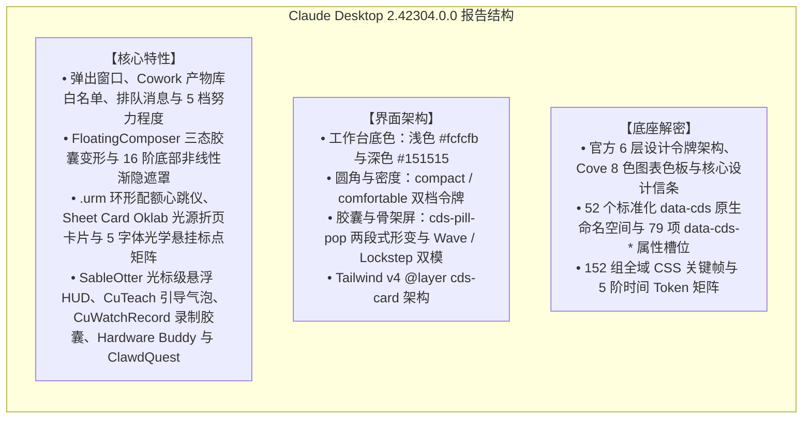

# Claude Desktop 2.42304.0.0 逆向分析与 CDS 设计系统报告

> **目标应用载体**：Anthropic 官方桌面端生产包 Windows MSIX `Claude_2.42304.0.0_x64__pzs8sxrjxfjjc`
> **二进制元数据**：`@ant/desktop v2.42304.0`（Build: `2026-10-15T05:54:05Z`，Commit: `e7f60e658f15cfece9efa384a78a39aec3c12845`，捆绑 CLI `2.1.299`，`app.asar` Evidence: `ev_db29cf6b5757fd86666fd272343cccd383bf391d00dac49aada8f2d616fa36c8`）
> **逆向工具栈**：**[REA (Reverse Engineer Anything)](https://github.com/morluto/rea)**：ASAR 解包、`ion-dist` CSS / JS 静态分析与 AST 解构。
> **网页版对照**：claude.ai 运行时实测（DOM 测量、CSSOM 遍历）见 [交互式故事书 · claude.ai 实测页](../claude-components-storybook.html#claude-ai-web)（W0–W22；W16–W22 是安装包全部可视化效果的盘点与复刻）。

---

## 目录

- [1. 综述](#1-综述)
  - [1.1 版本边界声明](#11-版本边界声明)
  - [1.2 核心设计契约：陶土品牌色克制守则与人声衬线分界（Clay Restraint & Serif Voice）](#12-核心设计契约陶土品牌色克制守则与人声衬线分界clay-restraint--serif-voice)
- [2. 核心特性](#2-核心特性)
  - [2.1 弹出窗口与窗口级页面搜索](#21-弹出窗口与窗口级页面搜索)
  - [2.2 Cowork 产物第三方库白名单与数据表格失活行](#22-cowork-产物第三方库白名单与数据表格失活行)
  - [2.3 排队消息（ChatComposerQueuedMessages）](#23-排队消息chatcomposerqueuedmessages)
  - [2.4 推理努力程度（Effort）](#24-推理努力程度effort)
  - [2.5 现代 CSS 动效系统](#25-现代-css-动效系统)
  - [2.6 触控负边距补偿](#26-触控负边距补偿)
  - [2.7 悬浮输入框三态几何变形与 16 阶渐隐遮罩 (FloatingComposer)](#27-悬浮输入框三态几何变形与-16-阶渐隐遮罩-floatingcomposer)
  - [2.8 环形配额仪表与三阶生理心跳曲线 (Usage Ring Meter - .urm)](#28-环形配额仪表与三阶生理心跳曲线-usage-ring-meter---urm)
  - [2.9 Oklab 光泽纸张卡片与标尺微动效 (Sheet Card & Document Rail)](#29-oklab-光泽纸张卡片与标尺微动效-sheet-card--document-rail)
  - [2.10 5 字体光学悬挂标点与字距补偿矩阵 (Optical Hanging Punctuation)](#210-5-字体光学悬挂标点与字距补偿矩阵-optical-hanging-punctuation)
  - [2.11 桌面全局多模态交互壳层 (SableOtter HUD、CuTeach、CuWatchRecord、Hardware Buddy 与 ClawdQuest)](#211-桌面全局多模态交互壳层-sableotter-hudcuteachcuwatchrecordhardware-buddy-与-clawdquest)
- [3. 界面架构](#3-界面架构)
  - [3.1 工作台画布底色](#31-工作台画布底色)
  - [3.2 基础圆角与密度系统](#32-基础圆角与密度系统)
  - [3.3 胶囊与骨架屏微交互](#33-胶囊与骨架屏微交互)
  - [3.4 章节标记（Pin as chapter）](#34-章节标记pin-as-chapter)
  - [3.5 Tailwind v4 CSS-First 引擎与样式共存 (window-shared.css & window-legacy-pins.css)](#35-tailwind-v4-css-first-引擎与样式共存-window-sharedcss--window-legacy-pinscss)
- [4. 底座解密](#4-底座解密)
  - [4.1 纯 CSS 动效参数](#41-纯-css-动效参数)
  - [4.2 原生组件命名空间](#42-原生组件命名空间)
  - [4.3 响应时间与贝塞尔曲线](#43-响应时间与贝塞尔曲线)
  - [4.4 官方 @ant/cds 六层令牌架构与 Cove 数据可视化设计体系](#44-官方-antcds-六层令牌架构与-cove-数据可视化设计体系)
- [5. 参考实现](#5-参考实现)
  - [5.1 模型选择与努力程度调节器](#51-模型选择与努力程度调节器)
  - [5.2 输入框底部工具行](#52-输入框底部工具行)
  - [5.3 动效引擎与微交互](#53-动效引擎与微交互)
- [6. 总结](#6-总结)
- [7. 全量盘点](#7-全量盘点)
  - [7.1 盘点口径与结果](#71-盘点口径与结果)
  - [7.2 需要特定条件才出现的效果](#72-需要特定条件才出现的效果)
  - [7.3 代码在、界面走不到的路径](#73-代码在界面走不到的路径)
  - [7.4 减少动效与强制颜色](#74-减少动效与强制颜色)
  - [7.5 对既有内容的更正](#75-对既有内容的更正)
  - [7.6 与故事书的对应](#76-与故事书的对应)

---

# 第一章：综述与版本边界

## 1. 综述

### 1.1 版本边界声明

本报告的分析对象是 Claude 桌面端生产包 **v2.42304.0**（`@ant/desktop@2.42304.0`，MSIX 包标识 `Claude_2.42304.0.0_x64__pzs8sxrjxfjjc`，Commit `e7f60e658f15cfece9efa384a78a39aec3c12845`，Build Timestamp `2026-10-15T05:54:05.000Z`）。

依托 REA 对该版本 `app.asar`（SHA-256: `8f4d3dec5e4f3ddffb150321060b18807d83a40f3a65618fe4f29325379da9db`，REA 证据 ID: `ev_db29cf6b5757fd86666fd272343cccd383bf391d00dac49aada8f2d616fa36c8`）及 `ion-dist/_frame-rt`（SHA-256: `bf7f0d4d90fe36017d28545260461bf654084e45b3abb4bb7e9a91d2acde81c0`，REA 证据 ID: `ev_22511fe4b0510120cb637aec50b4b588fa8a301da945139efa71bd25ad0e3587`）解包出的 `MainWindowPage-DTxMhyWF.css`、`c6a992d55-sXiDGMFQ.css`、`index.chunk-BYMGAPtw.js`（内嵌官方 `@ant/cds` 与 Imagine 规范）、`index.chunk-lzaSYO3Q.js` 以及 15 个 BrowserWindow 宿主入口的审查，本报告按以下结构组织：



同时，我们明确划分桌面端包与命令行独立发布的边界：
* **桌面端捆绑版本**：v2.42304.0 内部捆绑的 Claude Code CLI 清单为 **2.1.299**（Commit `c416f56ec7eca27e49747c35af51d5c92c856ba1`，`@anthropic-ai/claude-agent-sdk@0.3.299`），各平台二进制以 `.zst` 镜像分发；
* **多进程宿主边界**：Windows MSIX 生产包除主程序 `app\Claude.exe` 外，随包集成了 `cowork-svc.exe`、`claude-ssh-broker.exe`、`claude-ssh-proxy.exe`、`claude-ssh-askpass.exe`、`chrome-native-host.exe` 与 `smol-bin.x64.vhdx` 虚拟化镜像；
* **桌面版与网页版的关系**：普通账号（1P）下，主窗口的 `WebContentsView` 直接加载 `https://claude.ai`（`index.chunk-lzaSYO3Q.js` 中 `getMainWindowUrl()` 返回 Anthropic 源站），与网页版是同一份线上构建；随包的 `ion-dist` 单页应用（`app://localhost`）只在第三方推理（3P）模式下使用。网页版的运行时实测见 [故事书 · claude.ai 实测页](../claude-components-storybook.html#claude-ai-web)：两端行为不同的项在各节就地并排，桌面端独有功能见 [W15](../claude-components-storybook.html#wa-desktop)。

---

### 1.2 核心设计契约：陶土品牌色克制守则与人声衬线分界（Clay Restraint & Serif Voice）

从 `index.chunk-BYMGAPtw.js` 内嵌的 `@ant/cds` 官方规范（由 `apps/cds-docs/scripts/gen-cds-skill.mjs` 生成）中证实：Anthropic 明确确立了 **“Clay is Claude's color”** 与 **“Serif is Claude's voice”** 两大美学铁律——陶土色（`--fill-brand: #c6613f` / `--clay: #d97757`）严格保留给 **Claude 主动发起的动作**（如发送、生成、Spark 徽标与实时听写波形），普通用户主操作按钮一律使用中性主色（`--fill-primary`）或蓝色强调色（`--fill-accent`）；Claude 的回复正文与高光数据采用衬线体（`--font-voice` / `Anthropic Serif`），而外围应用壳层（Chrome）保持无衬线体（`--font-sans` / `Anthropic Sans`），使读者在阅读第一个词之前即可由字体感知说话者身份。

---

# 第二章：核心特性逆向

## 2. 核心特性

### 2.1 弹出窗口与窗口级页面搜索

会话与侧栏面板都可以弹出为独立窗口（Pop-out），每个弹出窗口各自承载一份 Find-in-Page（页面搜索）：

* **主进程**：`index.chunk-lzaSYO3Q.js` 导出 `asPopoutWindow` 与 `findInPageView`，`index.chunk-Ray2aCu3.js` 通过 `resolvePopoutWindowIncludingHidden(windowId)` 定位目标窗口及其 `webContents`；
* **预加载桥**：`mainView.js` 暴露 `FindInPageProvider_$_setProviderActive` 与 `FindInPageProvider_$_setProviderActiveInPopout`，页面搜索按窗口分别激活；
* **渲染层**：会话面板在弹出窗口中以 `isInsidePopoutWindow: true` 挂载（`c96d752d0-BOCqU7c2.js` 等），遥测字段 `in_popout` 区分主窗口与弹出窗口；
* **Code 会话工具描述**（`index.chunk-M6SkuaH9.js`）：会话可位于“主窗口、分屏窗格或弹出窗口”，`popped_out_panes` 列出只存在于独立窗口中的侧栏面板。

---

### 2.2 Cowork 产物第三方库白名单与数据表格失活行

`index.chunk-lzaSYO3Q.js` 的 `cowork-artifact` 模块为 Cowork 生成的 HTML 产物登记了可引用的第三方库，每项都是 jsDelivr 地址并附 `sha384` SRI 校验与使用提示：

| 库 | 地址 | 随附提示（原文摘要） |
| :--- | :--- | :--- |
| Chart.js 4.5.0 | `cdn.jsdelivr.net/npm/chart.js@4.5.0/dist/chart.umd.js` | UMD 全局 `Chart`；设置 `responsive: true, maintainAspectRatio: false`，容器可见后再建图 |
| Grid.js 5.0.2 | `cdn.jsdelivr.net/npm/gridjs@5.0.2/dist/gridjs.umd.js` | UMD 全局 `gridjs`，配套样式表 `gridjs@5.0.2/dist/theme/mermaid.min.css` |
| Mermaid 11.17.2 | `cdn.jsdelivr.net/npm/mermaid@11.17.2/dist/mermaid.min.js` | 全局 `mermaid`；`mermaid.initialize({ startOnLoad: true, securityLevel: "strict" })` |

数据表格的失活行规范（`c6a992d55-sXiDGMFQ.css`）：
```css
.cds-root [data-cds=DataTable] tr[data-dimmed] {
  --cds-row-dimmed-opacity: .5;
  --cds-text-primary: var(--cds-undimmed-text-stays-secondary);
  --cds-text-secondary: var(--cds-text-disabled);
  --cds-text-muted: var(--cds-text-disabled);
  --cds-text-stays-secondary: var(--cds-text-disabled);
}
/* 行内交互控件恢复 100% 亮度 */
.cds-root [data-cds=DataTable] tr[data-dimmed] :is(button,input,select,textarea,[role=button],[role=checkbox],[role=combobox],[role=menuitem],[role=radio],[role=slider],[role=switch],[role=tab]) {
  --cds-row-dimmed-opacity: 1;
  --cds-text-primary: var(--cds-undimmed-text-primary);
  --cds-text-secondary: var(--cds-undimmed-text-secondary);
  --cds-text-muted: var(--cds-undimmed-text-muted);
}
```

---

### 2.3 排队消息（`ChatComposerQueuedMessages`）

Claude 正在回复时继续发送的消息会进入排队区。`ChatComposerQueuedMessages` 是 `ChatComposerDock` 中的一个独立槽位（`c6a992d55-sXiDGMFQ.css` 中与 `ChatComposerNotices` 并列，不参与 dock 项之间的 `margin-bottom` 间距），排队条贴在输入框上沿（`cf74bc599-D9NZWRyl.js`）：

* **计数文案**：`{count, plural, one {# message queued} other {# messages queued}}`，以及 `1 message queued. Will send after the current response.`；
* **行内操作**：`Send now`（ghost · xs，快捷键 `cmd+enter`）、`Edit in composer`、`Remove from queue`；多条时可折叠、可拖动排序；
* **Send now 的说明**（`aria-describedby`）：`Stops Claude’s current step so it reads this message next.`，或 `Stops Claude’s current response.`。

交互演示见 [故事书 W14](../claude-components-storybook.html#wa-think)。

---

### 2.4 推理努力程度（Effort）

努力程度共 5 档 `low | medium | high | xhigh | max`，每档的说明文案（`shared-23-Bu_lvvVo.js` / `ion-dist/i18n/en-US.json`）：

| 档位 | 文案 |
| :--- | :--- |
| `low` | Quick replies to simple questions |
| `medium` | Light, casual tasks |
| `high` | Balanced for everyday work |
| `xhigh` | Complex, detailed work |
| `max` | The hardest problems. Takes longest. |

* **Max 警示**：`May use excessive tokens resulting in long response times and may hit token limits. Use sparingly for the hardest tasks.`
* **`maxEffort` 配置键**（`index.chunk-lzaSYO3Q.js` / `c6f6cf4c2-hWQ7JCh6.js` 的模型配置 schema，`availableInVersion: "2.110.0"`）：标签 `Max effort`，说明 `Highest effort level offered for this model; higher levels are hidden and never requested by Claude Desktop. An unrecognized value caps the model at low.`
* **网页版形态**：claude.ai 把努力程度收在模型菜单的子菜单里，默认推荐“中等”，见 [故事书 W5](../claude-components-storybook.html#wa-menus)。

---

### 2.5 现代 CSS 动效系统

#### 1. Modern CSS `sibling-index()` 原生级联交错渐入
官方直接落地了现代 CSS 的原生选择器计数函数：
```css
.cds-root { --cds-chip-in-base-delay: 50ms; }

@keyframes cds-chip-in {
  0% { opacity: 0; filter: blur(2px); transform: scale(.8); }
}

.cds-root .cds-chip-in {
  animation: cds-chip-in var(--cds-dur-base) var(--cds-ease-out) backwards;
  animation-delay: var(--cds-chip-in-base-delay, 50ms);
  animation-delay: calc(var(--cds-chip-in-base-delay, 50ms) + min(sibling-index() - 1, 8) * 30ms);
}
```

#### 2. View Transitions API 原生页面转场 (`cds-attachments`)
当用户在输入框中移除附件时，触发原生视图转场：
```css
:root:active-view-transition-type(cds-attachments)::view-transition-old(.cds-attachment):only-child {
  animation: .13s cubic-bezier(.55, .055, .675, .19) forwards cds-attachment-out;
}

@keyframes cds-attachment-out {
  to { opacity: 0; transform: scale(.5); }
}
```

#### 3. Scroll-Driven 滚动驱动渐变透明遮罩系统
滚动视口边缘不再使用纯色伪元素遮挡，而是直接绑定 CSS 滚动时间轴：
```css
@keyframes cds-scroll-fade-top {
  0% { --cds-scroll-fade-top-raw: 0px; }
  to { --cds-scroll-fade-top-raw: var(--cds-scroll-fade-size); }
}
```
* **效果**：长会话触顶时，顶部渐变遮罩变量为 `0px`（硬边缘）；一旦滚离顶部，展开为 `--cds-scroll-fade-size`（默认 `28px`）的羽化半透明渐变，平滑隐去上滑文字。

---

### 2.6 触控负边距补偿

在输入框底部操作行（`ChatComposerChin`），官方为触控设备设计了一套尺寸补偿算法（`c6a992d55-sXiDGMFQ.css`）：

```css
@media (pointer: coarse), (hover: none) {
  .cds-root [data-cds=ChatComposerChin] [data-touch-size] {
    /* 先把密度令牌全部 inherit 回外层（--cds-radius、--cds-h-control、--cds-icon、--cds-pad-*、--cds-checkbox* 等），再计算增量 */
    --cmp-chin-touch-grow: calc((var(--cds-h-control) - var(--cmp-chin-row-h, var(--cds-h-control))) / 2);
  }

  .cds-root [data-cds=ChatComposerChin] [data-touch-size] :is([data-cds=ButtonGroup],[data-cds=SplitDropdownButton]):not([data-size]),
  .cds-root [data-cds=ChatComposerChin] [data-touch-size] :is([data-cds=Button],[data-cds=ModelSelector],[data-cds=ModelSelectorEffort]):not([data-size]):not(:is([data-cds=ButtonGroup],[data-cds=SplitDropdownButton]) *) {
    margin-block: calc(var(--cmp-chin-touch-grow, 0px) * -1);
  }
}
```

* **机制**：只在粗指针或无悬停的设备上生效。`--cmp-chin-touch-grow` 算出控件标准高度与 Chin 行高的差值的一半，再用 `margin-block: calc(... * -1)` 把按钮的命中区向外扩，视觉行高保持不变，触控命中区达到标准控件高度。

---

### 2.7 悬浮输入框三态几何变形与 16 阶渐隐遮罩 (`FloatingComposer`)

在 `v2.42304.0` 的 `ion-dist/assets/v1/c0d1f1ea0-CRwfFWY4.css` 中，Anthropic 引入了悬浮式输入终端架构（`.fc-holder`），支持在 **把手态（`handle`）**、**胶囊态（`pill`）** 与 **完整编辑器态（`composer`）** 之间进行基于 `clip-path` 与圆锥渐变光环的丝滑几何变形：

```css
/* 提取自 ion-dist/assets/v1/c0d1f1ea0-CRwfFWY4.css */
.fc-holder {
  --fc-handle-w: 2rem;
  --fc-handle-h: 2rem;
  --fc-pill-h: 2.5rem;
  --fc-glyph-w: 1rem;
  --fc-glyph-gap: .5rem;
  --fc-pill-pad: 2.25rem;
  --fc-pill-w: calc(var(--fc-label-w, 4.75rem) + var(--fc-glyph-w) + var(--fc-glyph-gap) + 2 * var(--fc-pill-pad));
  --fc-d: var(--cds-dur-snap);
  --fc-e: var(--cds-ease-snap);
  --fc-arrive-ring: 1.8s;
  --fc-arrive-glow: 1.8s;
  --fc-arrive-ease: cubic-bezier(.6, 0, .1, 1);
}

/* 从胶囊内缩框向完整 Composer 圆角外框的 Clip-Path 展开动画 */
@keyframes fc-reveal {
  0% {
    clip-path: inset(
      calc(50% - var(--fc-pill-h) / 2)
      calc(50% - var(--fc-pill-w) / 2)
      calc(50% - var(--fc-pill-h) / 2)
      calc(50% - var(--fc-pill-w) / 2)
      round calc(var(--fc-pill-h) / 2)
    );
    opacity: .4;
  }
  to {
    clip-path: inset(-2rem round var(--cds-radius-composer));
    opacity: 1;
  }
}

/* 抵达时的 -95deg -> 265deg 旋转圆锥流光边环 */
.fc-holder[data-fc-arrive] > .fc-morph:before {
  filter: blur(.4px);
  background: conic-gradient(
    from var(--fc-edge-turn),
    transparent 0 50%,
    color-mix(in srgb, var(--fc-glow, var(--cds-fill-brand)) 42%, transparent) 82%,
    transparent 100%
  );
  animation: fc-arrive-ring var(--fc-arrive-ring) var(--fc-arrive-ease) both;
  padding: 1.5px;
  mask: linear-gradient(#000 0 0) content-box exclude, linear-gradient(#000 0 0);
}
```

* **16 阶超平滑底部非线性渐隐遮罩 (`.fc-scrim`)**：为了消除悬浮输入框下方长文档滚动的生硬边界，`.fc-scrim` 在 `15rem`（240px）高度内采用 **16 个 `color-mix()` 非线性采样点**（颜色权重依次为 `0% → 1.3% → 4.9% → 10.4% → 17.5% → 25.9% → 35.2% → 45% → 55% → 64.8% → 74.1% → 82.5% → 89.6% → 95.1% → 98.7% → 100%`），构成了对人眼对比度灵敏度曲线（CSF）零断层的余弦级过渡。

---

### 2.8 环形配额仪表与三阶生理心跳曲线 (`Usage Ring Meter` - `.urm`)

在 `ion-dist/assets/v1/c403c4b83-yqAXiELG.css` 中，逆向提取出了环形用量仪表（`.urm`）：一个带有**彗星尾迹（Comet）**与**三阶双搏生理心跳（Warning / Critical / Limit）**的精密圆环微组件：

```css
/* 提取自 ion-dist/assets/v1/c403c4b83-yqAXiELG.css */
.urm[data-entrance=draw] [data-ring-arc] {
  animation: urm-arc-sweep calc(2 * var(--cds-dur-slow)) var(--cds-ease-overshoot) backwards,
             urm-fade-in var(--cds-dur-snap) linear backwards;
}

/* 告警态、危急态与限流态的三阶双搏心跳周期 */
.urm[data-beat="1"] .urm__beat { animation: 2.3s linear urm-beat-warning; }
.urm[data-beat="2"] .urm__beat { animation: 1.45s linear urm-beat-critical; }
.urm[data-beat="3"] .urm__beat { animation: 2.45s linear urm-beat-limit; }
.urm[data-shimmer] .urm__breath { animation: 1.5s ease-in-out urm-breath; }
.urm[data-shimmer] .urm__comet { animation: 2s linear urm-comet-travel, 2s linear urm-comet-fade; }
```

* **双搏生理心跳数学模型**：`urm-beat-warning`（周期 `2.3s`）与 `urm-beat-critical`（周期 `1.45s`）并非简谐正弦缩放，而是精确采样了 **19 个关键帧时间点**，模拟人类心脏收缩与舒张的“主搏峰值 `scale(1.0352)` + 次搏回音 `scale(1.0192)`”双峰波形；而在 `data-beat="3"`（触达限流上限）时，峰值放大至 `scale(1.0458)` 并伴随 `32.9%` 光晕爆发。

---

### 2.9 Oklab 光泽纸张卡片与标尺微动效 (`Sheet Card` & `Document Rail`)

在 `c6a73f447-LaXKuzWp.css` 与 `c3fde7009-BH42YUtA.css` 中，Anthropic 为文档卡片（`[data-sheet-kind]`）与长文档阅读器（`.epitaxy-document-page`）注入了极具人文纸张触感的物理细节：

1. **Oklab 感知均匀色彩空间光泽扫掠**：
   卡片表面采用 `linear-gradient(var(--sheet-card-light-angle, 165deg) in oklab, rgb(255 255 255 / 0.55) 0%, transparent 55%)`。当鼠标悬停时，光源角度从 `165deg` 旋转至 `200deg`，光束触达范围从 `55%` 延伸至 `70%`；同时底层衬页（`.sheet-card-under`）以 `(50%, 62px)` 为轴心逆时针微旋 `-4deg` 并左移 `-2px`，呈现真实纸张叠放翻开的层次感。
2. **Epitaxy 文档边缘阅读进度刻度尺（`.epitaxy-document-rail`）**：
   长文档左侧悬浮 18px 宽的章节刻度线阵列（`.epitaxy-document-rail-ticks`）：一级标题缩放 `scale(0.5, 1)`、二级标题 `scale(0.3333, 1)`，当前阅读段落刻度变为强调色（`var(--cds-text-accent)`）并纵向加粗至 `scale(1, 1.5)`，仅在容器余量大于 `4.75rem`（`--document-rail-min-gutter`）时无感浮现。

---

### 2.10 5 字体光学悬挂标点与字距补偿矩阵 (`Optical Hanging Punctuation`)

在 `ion-dist/assets/v1/c4a9ee384-DqjuRPPC.css` 中，发现了 Anthropic 为文本排版专门构建的**光学悬挂标点与字偶距（Kerning）微调系统**：

```css
/* 提取自 ion-dist/assets/v1/c4a9ee384-DqjuRPPC.css */
[data-hang-face] { --reply-hang-room: 12px; }
[data-hang-face] blockquote { --reply-hang-room: 8px; }

[data-hang-face=serif] {
  --hq-dq: .4155em; --hq-dq-b: .4855em; --hq-dq-i: .4105em; --hq-dq-bi: .4665em;
  --hq-sq: .229em;  --hq-sq-b: .2525em;
  --hq-kern-oA: -.15em; --hq-kern-oJ: -.18em; --hq-kern-og: -.07em; --hq-kern-oa: -.03em;
  --hq-h1: .97; --hq-h2: .986; --hq-h3: .996;
}

span[data-hang-quote], span[data-hang-space] {
  --hq-hang: clamp(0px, (var(--hq-1, 0px) + var(--hq-2, 0px) + var(--hq-next, 0px)) * var(--hq-level, 1), var(--reply-hang-room, 0px));
}
span[data-hang-quote] { margin-inline-start: calc(-1 * var(--hq-hang)); }
```

* **设计美学动机**：当段落或标题以双引号 `“`、单引号 `‘` 开头时，若严格按字符边框对齐，引号下方的留白会在视觉左边界形成明显的“凹陷缺口”。Anthropic 针对 **`system`、`serif`、`sans`、`atkinson`（低视力无障碍字体）、`dyslexia`（阅读障碍友好字体）** 5 大字体族，分别精确测量了常规、粗体、斜体、粗斜体下的双引号/单引号宽度以及后续紧跟 `A / J / g / a` 字母时的负向字偶距（如 `--hq-kern-oJ: -0.18em`），通过 `margin-inline-start: calc(-1 * var(--hq-hang))` 将标点精准悬挂于最大 `12px` 的页边留白区内，达到印刷级光学左对齐。

---

### 2.11 桌面全局多模态交互壳层 (`SableOtter HUD`、`CuTeach`、`CuWatchRecord`、`Hardware Buddy` 与 `ClawdQuest`)

通过对 `v2.42304.0` 的 `app.asar` 主进程与独立渲染器目录（`.vite/renderer/` 与 `.vite/build/`）的逆向解构，完整还原了五大桌面原生交互形态：

| 模块名称 | 源码载体 | 几何与视觉美学规范 | 核心交互机制 |
| :--- | :--- | :--- | :--- |
| **SableOtter 光标级悬浮 HUD** | `index.chunk-BN7PaJ_P.js`<br/>`index.chunk-VXoZYQbU.js` | Strip 胶囊条（`border-radius: 18px`, `max-width: 590px`）与 Card 卡片（`width: 420px`, `border-radius: 14px`）双态；浅色 `rgba(255,255,255,0.97)` / 深色 `rgba(38,38,36,0.97)`；5 柱对称声学电平表 `height = 4 + 12 * level px` | 跟随系统任意应用输入光标（Caret）弹出；区分指令紫（`--tell: #6b5ec7`）与听写陶土橙（`--dictate: #d97757`）；自动过滤终端与密码框（1Password/Bitwarden 等） |
| **CuTeach 计算机使用教学浮层** | `computerUseTeach.js`<br/>`index.chunk-lzaSYO3Q.js` | `16px` 圆角气泡 + `::before` 17px `0.5px` 发丝内框；双层 `drop-shadow` 三角形锚点箭头；`300ms cubic-bezier(0.16, 1, 0.3, 1)` 缩放位移过渡 | 全屏透明穿透窗口（`setIgnoreMouseEvents(true, {forward: true})`），优先按 `below → above → right → left` 自动避让屏幕边缘；进入计算机控制时主窗口以 `220ms` 三次方缓动自动停靠为右侧 `520×720px` 边栏 |
| **CuWatchRecord 屏幕录制与技能提炼** | `computerUseWatchRecord.js`<br/>`watchRecordChooser.js` | 底部悬浮暗色毛玻璃胶囊（`472×112px` 含阴影余量，本体 `rgba(21,21,21,0.95)`, `border-radius: 12px`, `backdrop-filter: blur(10px)`）；8px `#d97757` 圆点 `pulse 1.5s`（opacity 1 → .4），「Capturing · m:ss」计时（250ms 刷新）与 Discard / Done 按钮 | 支持 `Share screen`（上下文录制）与 `Record a skill`（自动提炼可复用技能）双模式；Chooser 窗口内置 `INPUT_PROTECTION_MS` 防误触门禁；录制结束转为 900ms 圆环 + `Processing` 扫光态，并按实际内容宽度 `min(408, max(160, w)) + 64` 收缩窗口；胶囊窗口 `setContentProtection(true)`，不会被录进画面；只支持 Windows / macOS |
| **Hardware Buddy 创客蓝牙硬件终端** | `buddy_window/BuddyWindow-_Jgif_qX.js`<br/>`main-a4mzyXdA.css` | 暖米色画布（`--cream: #f4f3ee`）；左侧拟物化橙色硬件掌机预览（`115×245px`, `145deg` 渐变外壳，`77×134px` `image-rendering: pixelated` 像素屏与实体按键阴影） | 基于 Nordic UART Service (`6e400001-...`) BLE 协议连接外部创客硬件（如桌面电子宠物），每 10s 同步活跃会话数、今日 Token 消耗并支持硬件按键直接审批 `Bash` 工具权限（`once` / `deny`） |
| **ClawdQuest 离线断网彩蛋游戏** | `clawdQuestEngine-CdvdlRdl.js`<br/>`clawdQuestEngine-C2Z1JudX.css` | 断网报错页（`data-load-error-overlay`）底部提示 `Press Space to play`；叙事纸条采用 `#f3efe4` 底色 + 内联 SVG `feTurbulence`（`baseFrequency="1.15"`）分形噪点滤镜 + 不规则多边形 `clip-path` 模拟手工撕边羊皮纸：叙事纸条 13 顶点、倾斜 `-0.6deg`，开始纸条 10 顶点、倾斜 `+0.8deg` | 只在主视图加载失败（`load_failed`）且 GrowthBook 开关 `543332958` 打开时挂载（主进程 `dYn(…, { offersOfflineGame })`）；把报错页变成平台跳跃游戏，报错卡片自动折叠为顶部紧凑横幅（`data-compact`），并通过 `ResizeObserver` 动态避让游戏 HUD 顶栏 |


> 补充：电脑使用时还有一扇全屏透明的屏幕光晕窗口（cu-glow）。会话拿到电脑使用锁时，四周出现陶土色内阴影脉冲（`glow-pulse` 2s），中央徽标「Claude is using your computer」停约 5s 后飞向右上角（`badge-center-to-corner` 6s）；同时主窗口缩成右上角 520×720 侧边面板。ClawdQuest 的「Start game」开始纸条（`cq-slipIn`）只在引擎的 `boot` 模式出现，桌面离线页不传 `boot`，所以看不到。详见[7.2 需要特定条件才出现的效果](#72-需要特定条件才出现的效果)。
---

# 第三章：界面架构与样式系统

## 3. 界面架构

### 3.1 工作台画布底色

| 色彩令牌 / 属性 | 浅色模式 | 深色模式 | 出处 |
| :--- | :--- | :--- | :--- |
| **页面主画布 `--cds-surface-1`** | `#fcfcfb`（`gray-10`） | `#151515`（`gray-850`） | `c6a992d55-sXiDGMFQ.css` |
| **侧栏 / 底层 `--cds-surface-0`** | `#f9f9f7`（`gray-20`） | `#0b0b0b`（`gray-900`） | `c6a992d55-sXiDGMFQ.css` |
| **壳层窗口首帧底色 `--claude-background-color`** | `#fcfcfb` | `#151515` | `.vite/renderer/*/window-shared.css` |
| **页面底色绑定 `--cds-page-bg`** | 由 `Surface` 与浮层重映射（如 `var(--cds-surface-0)`、`transparent`） | 同左 | `c6a992d55-sXiDGMFQ.css` |

---

### 3.2 基础圆角与密度系统

`CdsRoot` 上的 `[data-density]` 在 `compact`（默认）与 `comfortable` 两档之间切换整套尺寸令牌（`c6a992d55-sXiDGMFQ.css`；像素值为 `--cds-rem-scale` = 1 时的名义值）：

| 物理量 / 设计令牌 | 紧凑模式 (Default Compact) | 舒适模式 (Comfortable) |
| :--- | :--- | :--- |
| **输入框圆角 `--cds-radius-composer`** | **`12px`** (`calc(.75rem * scale)`) | **`14px`** (`calc(.875rem * scale)`) |
| **基础控件圆角 `--cds-radius`** | **`6px`** (`calc(.375rem * scale)`) | **`8px`** (`calc(.5rem * scale)`) |
| **子面板/卡片圆角 `--cds-panel-radius`** | `10px` (`calc(.625rem * scale)`) | **`12px`** (`calc(.75rem * scale)`) |
| **复选框圆角 `--cds-checkbox-radius`** | `4px` (`calc(.25rem * scale)`) | **`5px`** (`calc(.3125rem * scale)`) |
| **基准控件高度 `--cds-h-control`** | **`24px`** (`calc(1.5rem * scale)`) | **`32px`** (`calc(2rem * scale)`) |
| **嵌套内联控件高 `--cds-h-control-nested`** | **`18px`** (`calc(1.125rem * scale)`) | **`22px`** (`calc(1.375rem * scale)`) |
| **基准图标尺寸 `--cds-icon`** | **`16px`** (`calc(1rem * scale)`) | **`20px`** (`calc(1.25rem * scale)`) |
| **组件间隙 `--cds-gap-xs/sm/md/lg/xl`** | **`6/8/12/20/32px`** | **`8/12/16/28/40px`** |

```css
/* 默认紧凑模式 (Compact Density) */
.cds-root {
  --cds-radius: calc(.375rem * var(--cds-rem-scale, 1));          /* 6px */
  --cds-radius-composer: calc(.75rem * var(--cds-rem-scale, 1));  /* 12px */
  --cds-h-control: calc(1.5rem * var(--cds-rem-scale, 1));        /* 24px */
  --cds-h-control-nested: calc(1.125rem * var(--cds-rem-scale, 1)); /* 18px */
  --cds-icon: calc(1rem * var(--cds-rem-scale, 1));               /* 16px */
}

/* 舒适模式 (Comfortable Density) */
.cds-root[data-density=comfortable] {
  --cds-radius: calc(.5rem * var(--cds-rem-scale, 1));           /* 8px */
  --cds-radius-composer: calc(.875rem * var(--cds-rem-scale, 1)); /* 14px */
  --cds-h-control: calc(2rem * var(--cds-rem-scale, 1));         /* 32px */
  --cds-h-control-nested: calc(1.375rem * var(--cds-rem-scale, 1)); /* 22px */
  --cds-icon: calc(1.25rem * var(--cds-rem-scale, 1));          /* 20px */
}
```

* **网页版取值**：claude.ai 以 comfortable 档为主（控件圆角 8px、输入框圆角 14px），各档密度变量与实测坐标见 [故事书 W2 / W10](../claude-components-storybook.html#wa-sidebar)。

---

### 3.3 胶囊与骨架屏微交互

#### 1. Pill 胶囊两段式弹性形变

先以 `--cds-ease-out` 放大到 `1.32` 倍，再以 `--cds-ease-overshoot` 过冲回弹：
```css
@keyframes cds-pill-pop-up { to { transform: scale(1.32); } }
@keyframes cds-pill-pop-down { 0% { transform: scale(1.32); } }

.cds-root .cds-pill-pop {
  animation: cds-pill-pop-up calc(var(--cds-dur-base) * .4) var(--cds-ease-out),
             cds-pill-pop-down calc(var(--cds-dur-base) * .6) var(--cds-ease-overshoot) calc(var(--cds-dur-base) * .4);
}
```

#### 2. Skeleton 骨架屏双模协同

* **同步呼吸模态 (`[data-motion=lockstep]`)**：整组以 2s 为周期变暗至 60% 后复原（`cds-skeleton-breathe`），适用于结构密集的列表；
* **波浪级联模态 (`[data-motion=wave]`)**：每个骨架块延迟 `var(--cds-skel-i) * 90ms`，配合 105° 倾角线性高光扫光带（`.cds-skel-sweep-band` · `cds-skeleton-sweep` 2s linear），适用于大卡片载入。

---

### 3.4 章节标记（Pin as chapter）

* **界面入口**：Code 会话消息的更多菜单提供 `Pin as chapter` / `Unpin chapter`（`c96d752d0-BOCqU7c2.js`，文案见 `ion-dist/i18n/en-US.json`），把某条消息标记为对话目录中的章节；
* **模型侧工具**：桌面版注入 Code 会话的系统说明（`index.chunk-M6SkuaH9.js`）要求模型在批量启动多个会话前先调用 `mcp__ccd_session__mark_chapter` 写入一个简短的章节标题（原文：Two or more at once: call `mcp__ccd_session__mark_chapter` first with a short batch title.）。

---

### 3.5 Tailwind v4 CSS-First 引擎与样式共存 (`window-shared.css` & `window-legacy-pins.css`)

在 `v2.42304.0` 的 `.vite/renderer/*/window-shared.css` 与 `window-legacy-pins.css` 中，完整暴露了桌面壳层窗口基于 **Tailwind v4 CSS-first 架构 + `@ant/cds` 原生主题包** 的样式组织方式：

1. **`@layer cds-card` 最低优先级锚点法则**：
   ```css
   /* 提取自 .vite/renderer/about_window/window-shared.css */
   @layer cds-card;
   @import "tailwindcss";
   @import "@ant/cds/theme.css";
   @import "@ant/cds/root-weight-pin.css";
   @config "../tailwind.config.js";
   ```
   必须在所有 `@import` 之前首行声明裸 `@layer cds-card;`，使 `cds-card` 层级排在级联表最底部（否则 `CdsRoot` 会在开发态抛出层级排序异常）。
2. **桌面端按钮指针约定（Arrow on Buttons, Pointer on Links）**：
   `window-legacy-pins.css` 源码注释证实：当 `.cds-root` 标记 `data-platform="desktop"` 时，`@ant/cds` 遵循桌面操作系统的人机界面约定，把交互按钮的光标令牌解析为 `cursor: default`（标准箭头），仅对超链接保留 `cursor: pointer`。尚未改用 CDS 组件、仍沿用 Tailwind v3 时期标记的壳层窗口（about / buddy / find_in_page / quick_window）在 `window-shared.css` 之后额外加载 `window-legacy-pins.css`，为按钮显式保留 `cursor: pointer`；某个窗口改用 CDS 组件后即不再引入该文件。
3. **首帧防白闪（Flash of Unstyled Light Theme）CSS 媒体查询同步**：
   由于 `windowBaseCore.ts` 需等待 JS 模块图加载完毕才会向 DOM 注入 `.darkTheme` 类，主窗口与子窗口在 CSS `:root` 层级直接通过 `@media (prefers-color-scheme: dark)` 预设 `--claude-background-color: #151515` 与 `--claude-text-500: #a6a39b`，根除冷启动首帧白闪。

---

# 第四章：系统底座全景解密

## 4. 底座解密

### 4.1 纯 CSS 动效参数

在 `v2.42304.0` 中，全包共有 **309 个 `@keyframes` 关键帧名**（同名多处定义按 1 个计），分布在 51 个文件里，其中第三方库 17 个；逐个的功能与触发条件见[第七章](#7-全量盘点)和故事书 W16。主样式表 `c6a992d55-sXiDGMFQ.css` 定义了其中 **152 个**；以 `cds-*` 为主的 **55 个 CDS 核心关键帧** 另被复制进 6 处本地窗口（about / buddy / find-in-page / quick-window 的内联 html、`MainWindowPage-DTxMhyWF.css`、`frame-window-054FFK51.js`）。主要家族如下：

* **Pill 微形变族**：`cds-pill-in`, `cds-pill-pop-up`, `cds-pill-pop-down`, `cds-pill-dip-down`, `cds-pill-dip-up`, `cds-pill-roll-in-up`, `cds-pill-roll-in-down`, `cds-pill-roll-out`, `cds-pill-out`
* **骨架屏呼吸与扫光族**：`cds-skeleton-breathe`, `cds-skeleton-sweep`, `cds-placeholder-reveal`
* **Agent 思考状态族**：`cds-dot-pulse`, `cds-working-dot-halo`, `cds-working-dot-lands`, `cds-working-dot-veil`
* **视口与滚动驱动族**：`cds-scroll-fade-top`, `cds-scroll-fade-bottom`, `cds-scroll-fade-left`, `cds-scroll-fade-right`, `cds-scroll-fade-x-active`, `cds-scroll-fade-y-active`, `cds-scroll-fade-strip-in`, `cds-scroll-fade-strip-out`, `cds-scroll-fade-strip-active`, `cds-sticky-edge-start`, `cds-sticky-edge-end`, `cds-sticky-edge-active`
* **元素进入退出与页面转场族**：`cds-reveal-in`, `cds-reveal-out`, `cds-fade-in`, `cds-slide-in-start`, `cds-slide-in-end`, `cds-morph-in`, `cds-chip-in`, `cds-attachment-out`, `cds-grid-rows-in`, `cds-flipbook`, `cds-page-tabs-arrive`, `cds-page-title-leaves`, `cds-drop-icon-rise`, `cds-drop-ring-in`, `cds-editor-comment-working`, `cds-resolve-glyph`, `cds-resolve-square`, `cds-um-enter`
* **专题动效族**：
  - **悬浮输入变形族**：`fc-reveal`, `fc-arrive`, `fc-arrive-ring`, `fc-rise`
  - **环形配额心跳族**：`urm-arc-sweep`, `urm-fade-in`, `urm-breath`, `urm-comet-travel`, `urm-comet-fade`, `urm-draw-glow`, `urm-beat-warning`, `urm-beat-warning-glow`, `urm-beat-critical`, `urm-beat-critical-glow`, `urm-beat-limit`, `urm-beat-limit-glow`
  - **纸张卡片绘制族**：`sheet-card-draw-x`, `sheet-card-draw-y`, `sheet-card-dash`, `sheet-card-pop`, `sheet-card-stamp`, `sheet-card-reveal-x`, `sheet-card-ride`, `sheet-card-blink`, `sheet-card-sweep`, `sheet-card-tighten`, `sheet-card-appear`
  - **文档审阅与流式字素族**：`epitaxy-document-landed`, `epitaxy-document-changed-a`, `epitaxy-document-changed-b`, `epitaxy-document-rail-in`, `prose-review-bar-in`, `prose-review-bar-icon-in`, `review-scroll-flash`, `_grapheme-reveal_1plog_1`, `vt-image-preview-decoration-in`, `vt-image-preview-decoration-out`

---

### 4.2 原生组件命名空间

在 `v2.42304.0` 中，Anthropic 定义了 **52 个标准 `data-cds` 顶级组件命名空间**（并配套 79 项 `data-cds-*` 内部结构槽位）：

```
[52 个标准化 data-cds 顶级组件清单]
• Accordion              • AccordionHeader        • Aside                  • AskUserQuestion
• AssistantMessage       • Banner                 • Button                 • ButtonGroup
• Card                   • CardLink               • ChartContainer         • ChatComposerActions
• ChatComposerChin       • ChatComposerDock       • ChatComposerEditor     • ChatComposerNotices
• ChatComposerQueuedMessages • Checkbox           • Collapsible            • CommentCard
• DataTable              • FileDiff               • Icon                   • MessageActions
• MessageAttachments     • MessageAttachmentsFile • MessageAttachmentsImage• MessageAttachmentsQuote
• MessageAttachmentsVideo• ModelSelector          • ModelSelectorEffort    • OverflowTooltip
• Panel                  • PointChartContainer    • PreviewCard            • Prose
• Pulse                  • Skeleton               • SkeletonGroup          • SplitDropdownButton
• Surface                • Switch                 • Table                  • Tabs
• TextArea               • TextInput              • TextLink               • Toolbar
• TurnStatus             • TurnStatusStep         • UserMessage            • VideoPlayer
```

---

### 4.3 响应时间与贝塞尔曲线

#### 1. 5 阶响应时间 Token 矩阵

```css
:root {
  --cds-dur-fast: 60ms;        /* 瞬态响应：按压塌陷、Focus 环显现、Checkbox 勾选 */
  --cds-dur-snap: .12s;        /* 利落转场 (120ms)：Pill 收缩、标签关闭、微图标翻转 */
  --cds-dur-base: .2s;         /* 标准交互 (200ms)：模态框展开、卡片悬停上浮、下拉菜单 */
  --cds-dur-sheet: .3s;        /* 抽屉大面板 (300ms)：NewSessionDrawer 滑出、文件侧栏 */
  --cds-dur-slow: .45s;        /* 页面级大转场 (450ms)：Popout 弹射窗口初始化、全屏遮罩 */
}
```

#### 2. 3 大精确贝塞尔控制点

```css
:root {
  /* 1. 平滑自然减速曲线 (Quint-like Out) */
  --cds-ease-out: cubic-bezier(.165, .84, .44, 1);

  /* 2. 瞬态刚性捕捉曲线 (Crisp Snap) */
  --cds-ease-snap: cubic-bezier(.32, .72, 0, 1);

  /* 3. 物理过冲回弹曲线 (Spring Overshoot) */
  --cds-ease-overshoot: cubic-bezier(.34, 1.3, .64, 1);

  /* 4. 15 阶原生 CSS linear() 物理按钮弹簧曲线 (+9.15% 过冲) */
  --cds-btn-spring: linear(0, 0.2459, 0.6526, 0.9468, 1.0764, 1.0915, 1.0585, 1.0219, 0.9993, 0.9914, 0.9921, 0.9957, 0.9988, 1.0004, 1);
}
```

---

### 4.4 官方 `@ant/cds` 六层令牌架构与 Cove 数据可视化设计体系

从 `v2.42304.0` 的 `.vite/build/index.chunk-BYMGAPtw.js` 中，我们直接提取出了由 `apps/cds-docs/scripts/gen-cds-skill.mjs` 从 `packages/cds/{CLAUDE.md,docs/**}` 自动生成的 **官方 CDS 内部设计规范与令牌模型**：

#### 1. 官方 6 层设计令牌模型 (The 6-Layer Token Model)

| 层级 | 令牌命名空间 | 物理机制与暗黑反转规则 | 组件消费约束 |
| :--- | :--- | :--- | :--- |
| **1. Base Palette** | `--{hue}-{stop}` | 9 大色相（`gray, red, orange, yellow, green, aqua, blue, violet, magenta`）共享 36 阶网格（`0, 10~100, 150~800, 810~900`），锚定 `0 = #ffffff` 与 `900 = #0b0b0b`，跨浅/深模式保持绝对像素不变 | 内部底层接线，组件禁止直接引用 |
| **2. Theme Ramps** | `--neutral-N` / `--alpha-N` | 浅色下 `neutral-N = gray-N`，深色下自动反转为 `gray-(900-N)`；`--alpha-N` 为 `neutral-900` 的固定透明度（`5% ~ 95%`） | 内部底层接线，自动完成明暗翻转 |
| **3. Elevation** | `--surface-{0..3}` | 在浅色与深色模式下均遵守“0 最暗、3 最亮”绝对明度序（Light: `gray-20/10/0/0`；Dark: `gray-900/850/830/800`） | 由 `Surface` 与浮层重映射 `--page-bg` |
| **4. Purpose** | `--surface-{popover,panel}`、`--text-*`、`--fill-*`、`--bg-*`、`--border-*` | 6 大语义角色（`accent` 蓝、`brand` 陶土、`danger` 红、`success` 绿、`warning` 黄、`pro` 紫）及 `git-*` 状态色；区分饱和实心控件色 `fill-{role}` 与柔和背景淡彩 `bg-{role}` | **所有 UI 组件唯一允许直接消费的语义层** |
| **5. Density** | `--h-control*`、`--pad-*`、`--gap-*`、`--radius` | 由 `CdsRoot` 上的 `[data-density]` 单一开关全局切换 `compact`（开发工具/高密工作台）与 `comfortable`（消费级应用） | 组件尺寸与排版唯一消费层 |
| **6. Motion** | `--dur-{fast,snap,base,sheet,slow}`、`--ease-*` | 与主题模式和密度解耦的物理时间与缓动曲线常量 | 全局动效过渡消费层 |

#### 2. 半透明芯片色调逆混色方程 (`--bg-tint-{hue}`)

为了使 `Badge` 等半透明彩色标签在普通 `surface-1` 背景上叠加后，视觉颜色与不透明的 `bg-{role}`（浅色 `hue-100`、深色 `hue-800`）完全一致，同时又能透出底部的悬停态底色，Anthropic 使用 CSS 相对颜色语法（Relative Color Syntax）构建了逆混色方程：
```css
/* 浅色模式：基于 35% Alpha 反向求解 RGB 通道 (163.8 = 252 * 0.65) */
--bg-tint-blue: rgb(from var(--blue-100) calc((r - 163.8) / 0.35) calc((g - 163.8) / 0.35) calc((b - 163.15) / 0.35) / 35%);
/* 深色模式：基于 75% Alpha 反向求解 RGB 通道 (5.25 = 21 * 0.25) */
--bg-tint-blue: rgb(from var(--blue-800) calc((r - 5.25) / 0.75) calc((g - 5.25) / 0.75) calc((b - 5.25) / 0.75) / 75%);
```

#### 3. Cove 数据可视化 8 色分类标准色板与铁律

在内置的 `@ant/imagine-server` 与图表规范中，Anthropic 规定所有分类数据可视化必须严格按固定顺序使用 **Cove 8 色色板**（严禁循环取色或生成第 9 种彩虹色，超出 8 类的序列必须折叠为 `Other` 或拆分为分面小图 Small Multiples）：

| 槽位 | 色相 (Hue) | 浅色模式 HEX | 深色模式 HEX | 对应 CDS 令牌 |
| :---: | :--- | :--- | :--- | :--- |
| **1** | Blue | `#2a78d6` | `#3987e5` | `var(--chart-categorical-1)` |
| **2** | Orange | `#eb6834` | `#d95926` | `var(--chart-categorical-2)` |
| **3** | Aqua | `#1baf7a` | `#199e70` | `var(--chart-categorical-3)` |
| **4** | Yellow | `#eda100` | `#c98500` | `var(--chart-categorical-4)` |
| **5** | Magenta | `#e87ba4` | `#d55181` | `var(--chart-categorical-5)` |
| **6** | Green | `#008300` | `#008300` | `var(--chart-categorical-6)` |
| **7** | Violet | `#6250d6` | `#9085e9` | `var(--chart-categorical-7)` |
| **8** | Red | `#e34948` | `#e66767` | `var(--chart-categorical-8)` |

* **可视化非妥协铁律（Non-negotiables）**：
  - **严禁双 Y 轴（One y-axis）**：不同量纲必须拆分为两张图或指数化处理；
  - **文字永不染序列色**：数值、坐标轴与图例文字永远使用 `--text-primary/secondary/muted`，仅用文字旁 10×10px（`border-radius: 2px`）色块标识序列；
  - **禁止对文本使用 `opacity`**：透明度会与背景色相乘导致跨表面色偏，次要文本必须使用 `--text-secondary`；
  - **高光大数字（Hero Number）**：统计卡片主数值采用 `--font-voice`（`Anthropic Serif`）`≥ 48px` 并开启 `tabular-nums lining-nums`。

---

# 第五章：生产级参考实现代码

## 5. 参考实现

### 5.1 模型选择与努力程度调节器

> 📄 **独立工程源码**：[`code-examples/ModelSelectorEffort.tsx`](../../code-examples/ModelSelectorEffort.tsx)（已集成至 `src/index.ts`）。各档说明与 Max 警示文案取自 2.42304.0.0 的 `ion-dist/i18n/en-US.json`，默认推荐档与 claude.ai 一致（中等）。

```tsx
import React, { useState } from 'react';

export type EffortLevel = 'low' | 'medium' | 'high' | 'xhigh' | 'max';

export interface ModelEffortConfig {
  effortLevels: EffortLevel[];
  recommended: EffortLevel;
  modes: ('auto' | 'extended' | 'off')[];
  disallowThinkingDisabled?: boolean;
}

export const EFFORT_META: Record<EffortLevel, { name: string; desc: string; warning?: string }> = {
  low: { name: 'Low', desc: 'Quick replies to simple questions' },
  medium: { name: 'Medium', desc: 'Light, casual tasks' },
  high: { name: 'High', desc: 'Balanced for everyday work' },
  xhigh: { name: 'Extra', desc: 'Complex, detailed work' },
  max: {
    name: 'Max',
    desc: 'The hardest problems. Takes longest.',
    warning: 'May use excessive tokens resulting in long response times and may hit token limits. Use sparingly for the hardest tasks.'
  }
};

export const ModelSelectorEffort: React.FC<{
  currentEffort: EffortLevel;
  onEffortChange: (effort: EffortLevel) => void;
  config?: ModelEffortConfig;
}> = ({
  currentEffort,
  onEffortChange,
  config = {
    effortLevels: ['low', 'medium', 'high', 'xhigh', 'max'],
    recommended: 'medium',
    modes: ['auto']
  }
}) => {
  const [isOpen, setIsOpen] = useState(false);
  const activeMeta = EFFORT_META[currentEffort];

  return (
    <div className="relative inline-block text-left" data-cds="ModelSelectorEffort">
      {/* 触发胶囊按钮 */}
      <button
        type="button"
        onClick={() => setIsOpen(!isOpen)}
        className="inline-flex items-center gap-1.5 px-2.5 py-1 text-xs font-medium rounded-full bg-[var(--cds-bg-secondary,#F3EFE0)] text-[var(--cds-text-primary,#1F1E1D)] hover:bg-[var(--cds-bg-tertiary,#E8E4D5)] transition-colors border border-[var(--cds-border-subtle,rgba(0,0,0,0.08))]"
      >
        <span className="w-1.5 h-1.5 rounded-full bg-[var(--cds-accent,#D97706)] animate-pulse" />
        <span>Thinking: {activeMeta.name}</span>
        {currentEffort === config.recommended && (
          <span className="text-[10px] px-1 py-0.2 rounded bg-[var(--cds-fill-badge-neutral,rgba(0,0,0,0.06))] text-[var(--cds-text-secondary,#6B6966)]">
            Default
          </span>
        )}
      </button>

      {/* 下拉面板 */}
      {isOpen && (
        <div className="absolute bottom-full left-0 mb-2 w-72 rounded-xl shadow-xl bg-[var(--cds-surface,#FCFBF7)] border border-[var(--cds-border-subtle,rgba(0,0,0,0.1))] p-2 z-50 animate-in fade-in zoom-in-95 duration-150">
          <div className="px-2 py-1.5 border-b border-[var(--cds-border-subtle,rgba(0,0,0,0.06))] mb-1.5">
            <p className="text-xs font-semibold text-[var(--cds-text-primary,#1F1E1D)]">Thinking Effort</p>
            <p className="text-[11px] text-[var(--cds-text-secondary,#6B6966)] leading-tight mt-0.5">
              Higher effort means more thorough responses, but takes longer and uses limits faster.
            </p>
          </div>

          <div className="space-y-1">
            {config.effortLevels.map((lvl) => {
              const meta = EFFORT_META[lvl];
              const isSelected = lvl === currentEffort;
              const isRecommended = lvl === config.recommended;

              return (
                <button
                  key={lvl}
                  type="button"
                  onClick={() => {
                    onEffortChange(lvl);
                    setIsOpen(false);
                  }}
                  className={`w-full text-left px-2.5 py-2 rounded-lg text-xs transition-all flex items-start justify-between ${
                    isSelected
                      ? 'bg-[var(--cds-fill-accent-subtle,#FEF3C7)] text-[var(--cds-text-accent,#92400E)] font-medium'
                      : 'hover:bg-[var(--cds-bg-secondary,#F3EFE0)] text-[var(--cds-text-primary,#1F1E1D)]'
                  }`}
                >
                  <div>
                    <div className="flex items-center gap-1.5">
                      <span>{meta.name}</span>
                      {isRecommended && (
                        <span className="text-[9px] px-1 rounded bg-[var(--cds-fill-badge-neutral,rgba(0,0,0,0.08))] text-[var(--cds-text-secondary,#6B6966)]">
                          Recommended
                        </span>
                      )}
                    </div>
                    <div className="text-[11px] text-[var(--cds-text-secondary,#6B6966)] mt-0.5 font-normal">
                      {meta.desc}
                    </div>
                    {meta.warning && lvl === 'max' && (
                      <div className="text-[10px] text-amber-700 bg-amber-50 p-1.5 rounded mt-1 border border-amber-200 leading-tight">
                        ⚠️ {meta.warning}
                      </div>
                    )}
                  </div>
                  {isSelected && <span className="text-amber-600 text-sm">✓</span>}
                </button>
              );
            })}
          </div>
        </div>
      )}
    </div>
  );
};
```

---

### 5.2 输入框底部工具行

> 📄 **独立工程源码**：[`code-examples/ChatComposerChin.tsx`](../../code-examples/ChatComposerChin.tsx)（已集成至 `src/index.ts`）。Chin 渲染在输入框卡片外、卡片下方；排队消息条贴在输入框上沿，不属于 Chin（见 2.3）。

```tsx
import React from 'react';
import { ModelSelectorEffort, EffortLevel } from './ModelSelectorEffort';

export interface ChatComposerChinProps {
  currentEffort: EffortLevel;
  onEffortChange: (effort: EffortLevel) => void;
}

/** Chin 渲染在输入框卡片外、卡片下方（claude.ai 实测），不要放进卡片内部。 */
export const ChatComposerChin: React.FC<ChatComposerChinProps> = ({
  currentEffort,
  onEffortChange
}) => {
  return (
    <div
      className="cds-root w-full border-t border-[var(--cds-border-subtle,rgba(0,0,0,0.08))] bg-[var(--cds-surface,#FCFBF7)] px-3 py-1.5"
      data-cds="ChatComposerChin"
    >
      {/* 下颌操作行 (自带触控补偿) */}
      <div
        data-touch-size="true"
        className="flex items-center justify-between min-h-[28px]"
        style={{
          // 原生 CDS 负边距补偿算法
          '--cds-h-control': '36px',
          '--cmp-chin-row-h': '28px',
        } as React.CSSProperties}
      >
        <div className="flex items-center gap-2">
          {/* 模型与推理调节器 */}
          <ModelSelectorEffort currentEffort={currentEffort} onEffortChange={onEffortChange} />
          
          <button
            type="button"
            data-cds="Button"
            className="px-2 py-1 text-xs text-neutral-600 hover:text-neutral-900 rounded hover:bg-neutral-100 transition-colors"
          >
            + Attach
          </button>
        </div>

        <div className="flex items-center gap-2">
          <span className="text-[11px] text-neutral-400">⌘ + Enter to send</span>
          <button
            type="button"
            data-cds="Button"
            className="w-7 h-7 rounded-full bg-neutral-900 text-white flex items-center justify-center hover:bg-neutral-800 transition-colors"
          >
            ↑
          </button>
        </div>
      </div>
    </div>
  );
};
```

---

### 5.3 动效引擎与微交互

> 📄 **独立工程源码**：[`code-examples/CdsMotionEngine.tsx`](../../code-examples/CdsMotionEngine.tsx)（已集成至 `src/index.ts`）

```tsx
import React, { useState } from 'react';

export const CdsMotionEngine: React.FC = () => {
  const [popped, setPopped] = useState(false);
  const chips = ['AST-Engine', 'Electron-Fuses', 'View-Transitions', 'Scroll-Timeline', 'Sibling-Index'];

  return (
    <div className="p-6 space-y-6 bg-[#FCFBF7] rounded-xl border border-neutral-200">
      <h3 className="text-sm font-bold text-neutral-800">CDS 动效引擎实机呈现</h3>

      {/* 1. Pill 弹性过冲 */}
      <div>
        <p className="text-xs text-neutral-500 mb-2">1. Pill Elastic Pop (1.32x Overshoot)</p>
        <button
          type="button"
          onClick={() => {
            setPopped(true);
            setTimeout(() => setPopped(false), 240);
          }}
          className={`group/btn relative isolate px-3 py-1.5 rounded-full text-white text-xs font-medium transition-transform ${
            popped ? 'scale-125' : 'scale-100'
          }`}
          style={{
            transitionTimingFunction: 'cubic-bezier(0.34, 1.3, 0.64, 1)',
            transitionDuration: '200ms'
          }}
        >
          <span aria-hidden="true" className="cds-btn-squish absolute inset-0 -z-10 rounded-[inherit] bg-amber-600" />
          Pill Spring Trigger
        </button>
      </div>

      {/* 2. Chip 原生级联交错渐入 */}
      <div>
        <p className="text-xs text-neutral-500 mb-2">2. Staggered Chip Cascade Entrance</p>
        <div className="flex flex-wrap gap-2">
          {chips.map((chip, idx) => (
            <span
              key={chip}
              className="px-2.5 py-1 text-xs rounded-md bg-neutral-100 border border-neutral-200 text-neutral-700 animate-in fade-in zoom-in-75 duration-200"
              style={{
                animationDelay: `${idx * 30}ms`,
                animationFillMode: 'backwards'
              }}
            >
              {chip}
            </span>
          ))}
        </div>
      </div>

      {/* 3. Skeleton 105deg 线性扫光带 */}
      <div>
        <p className="text-xs text-neutral-500 mb-2">3. Skeleton 105° Linear Sweep (Wave Mode)</p>
        <div className="space-y-2 max-w-sm">
          <div className="h-3.5 rounded bg-neutral-200/60 overflow-hidden relative">
            <div
              className="absolute inset-0 -translate-x-full animate-[sweep_2s_infinite]"
              style={{
                backgroundImage: 'linear-gradient(105deg, transparent 35%, rgba(255,255,255,0.8) 50%, transparent 65%)'
              }}
            />
          </div>
          <div className="h-3.5 w-2/3 rounded bg-neutral-200/60 overflow-hidden relative">
            <div
              className="absolute inset-0 -translate-x-full animate-[sweep_2s_infinite]"
              style={{
                animationDelay: '90ms',
                backgroundImage: 'linear-gradient(105deg, transparent 35%, rgba(255,255,255,0.8) 50%, transparent 65%)'
              }}
            />
          </div>
        </div>
      </div>
    </div>
  );
};
```

---

# 第六章：总结

## 6. 总结

Claude 桌面端 2.42304.0.0 的界面与 CDS 设计规范可以归纳为三个层面：

1. **结构规范化**：**52 个 `data-cds` 顶级命名空间与 79 项 `data-cds-*` 结构槽位**，官方 6 层设计令牌架构、Cove 8 色可视化标准色板与 Tailwind v4 `@layer cds-card` 级联体系；
2. **动效与排版物理化**：**5 阶响应时间 Token、15 阶 `linear()` 按钮弹簧、全包 309 个关键帧（主样式表 152 个）、16 阶非线性渐隐遮罩、三阶双搏生理心跳曲线与 5 字体光学悬挂标点矩阵**，动效由 CSS 关键帧与 Scroll-Driven 时间轴承担，不占用流式输出时的主线程；
3. **全场景桌面原生化**：弹出窗口与窗口级页面搜索、排队消息，以及 **SableOtter 光标级悬浮 HUD、CuTeach 教学穿透气泡、CuWatchRecord 屏幕录制与技能提炼胶囊、Hardware Buddy 创客蓝牙终端与 ClawdQuest 手工撕边羊皮纸离线彩蛋**；
4. **条件触发的隐藏效果**：相当一部分效果只在特定条件下出现，例如电脑使用时的屏幕光晕、模型调用天气工具后的天气卡片、升级后的庆祝页票券和 Imagine 可视化部件；还有一批样式和组件都在、但本版本代码路径走不到的效果。完整盘点见[第七章](#7-全量盘点)。

网页版（claude.ai）的运行时实测见 [交互式故事书 · claude.ai 实测页](../claude-components-storybook.html#claude-ai-web)（W0–W22）：两端行为不同的项在各节就地并排，桌面端独有功能单列在 W15；W16–W22 是安装包全部可视化效果的盘点与复刻，对应[第七章](#7-全量盘点)。

---

# 第七章：隐藏与条件触发效果

本章把 Claude Desktop 2.42304.0.0 安装包里的可视化效果完整过了一遍，重点是平时看不到、要满足特定条件才出现的效果。交互复刻在故事书 claude.ai 实测页的 [W16–W22](../claude-components-storybook.html#wa-census)，本地窗口部分在 [W15](../claude-components-storybook.html#wa-desktop) 的后半部分。

## 7. 全量盘点

### 7.1 盘点口径与结果

**方法**：纯静态分析，没有运行 `claude.exe`，也没有附加或读取任何正在运行的 Claude 进程。

1. 用只读脚本扫描安装包里全部 `.css` / `.html` / `.js` 文本，收集 `@keyframes` 名与定义所在的文件：`ion-dist`（内置的 claude.ai 前端）和 `app.asar`（主进程、预加载脚本、本地渲染窗口）。
2. 对每个关键帧，找出引用它的 `animation` 声明（样式表与 JS 内联样式都扫），再按类名在 JS 里追到谁加上这个类、在什么条件下加。条件包括路由、组件状态、GrowthBook 开关、平台、RTL、减少动效等。
3. 不靠关键帧的效果另列，包括 View Transition、canvas / WebGL、Lottie、动图视频和原生窗口。
4. REA 证据：`analyze_javascript_application` 用 `source_paths` 限定范围，分析了两组文件。
   - app.asar 的 12 个本地窗口与预加载脚本：`ev_74e299b3…`，app.asar sha256 `8f4d3dec…5379da9db`。
   - ion-dist 的 6 个功能 chunk：`ev_63b65e99…`，ion-dist 目录 sha256 `c52bb551…dc2521`，0 个解析失败。

**结果**：

| 项目 | 数量 |
| :--- | :--- |
| 关键帧名（同名多处定义按 1 个计） | **309** 个，分布在 51 个文件 |
| 主样式表 `c6a992d55-sXiDGMFQ.css` | 152 个 |
| Artifact 外壳 `frame-shell-chrome-CAw-tYzh.js` 内嵌副本 | 61 个 |
| 55 个 CDS 关键帧的副本 | 6 处：about / buddy / find-in-page / quick-window 四个窗口的 html、`MainWindowPage-DTxMhyWF.css`、`frame-window-054FFK51.js` |
| 第三方库内部 | 17 个：Monaco、ProseMirror、CodeMirror、Mermaid |
| 盘点前故事书已出现的 | 44 个（按完整标识符匹配） |
| 本次补齐的 | **250** 个（不含第三方） |
| 非关键帧效果 | 153 项 |

按分析方向分组：

| 方向 | 关键帧 | 主要来源 | 故事书 |
| :--- | :--- | :--- | :--- |
| CDS 原语与外壳 | 94 | 主样式表、`frame-shell-chrome`、`shared-styles-Bl9zqrv-.css` | W17 |
| Code 与工作流 | 55 | `c96d752d0`、`c3fde7009`、`cc1aae219` 等 | W18 |
| 对话与通用 UI | 37 | 主样式表 `.animate-*` 工具类 | W19 |
| 条件触发的功能场景 | 40 | `cc0c7aeb5`（天气）、主样式表 | W20 |
| 功能模块自带样式 | 56 | 16 个功能 chunk 的内联 CSS、`c6a73f447` | W21 |
| 模型生成部件 | 6 | `cde7c3a92` / `asar build/index.chunk-BYMGAPtw.js` | W22 |
| 桌面本地窗口 | 5 | `asar build/index.chunk-lzaSYO3Q.js`、`clawdQuestEngine` | W15 |
| 第三方库 | 16 | Monaco、ProseMirror、CodeMirror、Mermaid | W16（只列参数） |

### 7.2 需要特定条件才出现的效果

| 效果 | 出现位置 | 触发条件 | 证据 | 故事书 |
| :--- | :--- | :--- | :--- | :--- |
| 电脑使用屏幕光晕：`glow-pulse` 2s、徽标 `badge-center-to-corner` 6s、`dot-pulse` 1.8s | 所选显示器全屏透明窗口（screen-saver 层级、忽略鼠标） | 会话拿到电脑使用独占锁（`cuLockChanged`）。同时主窗口用 220ms 缩成右上角 520×720 侧边面板，徽标终点 `100% − 280px` 落在面板中线上。释放锁时 0.3s 淡出，320ms 后隐藏 | `lzaSYO3Q` `TVr` / `IVr()` / `LVr()` / `RVr()` | W15 |
| CuTeach 教学浮层 | 工作区大小的穿透窗口 | 模型调用 `request_teach_access` 并获批后，每个 `teach_step` 推一步；按下 → 上 → 右 → 左避让屏幕边缘 | `lzaSYO3Q` `uLa()` / `SLa()` | W15 |
| 录制选择器与录制胶囊（「Capturing · m:ss」、Discard / Done、Processing 扫光） | 主屏幕工作区底部居中 | Windows / macOS 上从输入框发起 Record a skill 或 Share screen；胶囊窗口设了内容保护，不会被录进画面 | `lzaSYO3Q` `gRa()` / `TBa()` / `DBa()` | W15、第 09 章 9.6 |
| 离线小游戏 ClawdQuest | 主窗口加载失败覆盖层 | `load_failed` 且 GrowthBook 开关 `543332958` 打开。`JJn` 默认是 `() => !1`，主窗口创建主视图时被 `dYn(…, { offersOfflineGame: () => ey("543332958") })` 改写 | `lzaSYO3Q` `YJn()` / `dYn()` | W15 |
| 天气工具卡片：9 个 `weather-*` 关键帧加 canvas 粒子 | 对话里的工具卡片 `WeatherToolUseCell` | 模型调用 `weather_fetch`。天空按 `current.condition`（14 种）× `current.is_day` 选择，与应用深浅色无关 | `cc0c7aeb5-Di8hlO-L.js` | W20 |
| 安静时段画布 `hide-after-hold` | 整窗盖层 | GrowthBook `cardinal` 打开，reflections 设置里的 `quiet_hours` 覆盖当前本地时间（可跨午夜） | 主样式表 `.animate-quiet-hours-canvas-release` | W20 |
| 重启倒计时 `lf-enter` / `lf-drain` / `lf-tick` | 桌面端整窗盖层 | 登录、退出登录、应用 3P 配置等需要重启时 | `.animate-relaunch-*` | W20 |
| Guest Pass 票面与赠送票券 | 用户菜单的分享弹窗；Code 项目频道通知 | referral 资格可用；`onboarding_grant` 通知；点击票券时晃动和扫光 | `guest-pass-shimmer`、`ticket-*` | W20 |
| 命令面板行操作卡 `palette-card-*` | cmdk 命令面板 | 选中行后按 Alt+Enter 或点行尾按钮 | 主样式表 | W20 |
| 设置项深链高亮 `feature-anchor-*` | 设置页、管理员设置 | 带 #锚点打开、设置搜索、上手清单定位；有 RTL 版本 | 主样式表 | W20 |
| 用量环 draw / quiet 入场 | 输入框用量环、Code 页脚 | 每个用量窗口（`orgUuid:resetsAt`）第一次在本机显示时播 draw（1200ms），之后播 quiet（200ms） | `c403c4b83`、`cb979c293` | W20、第 09 章 9.2 |
| Claude Code 升级庆祝页票券 `ccc-*` | `/cli_landing` | 网页端升级支付成功后，按 GrowthBook 实验 `cc_celebration_post_upgrade` 跳转。桌面 App、Max 套餐和移动端不会被自动送到这里 | `ce78157a2-mEBrZTqq.js`、`cbbbe68ed` | W21 |
| 安装中心插画 `install-hub-*` | `/downloads`、Cowork 下载步 | 动态配置 `claude_ai_install_hub_config.enabled`；悬停卡片才动 | `ce985dfcc-DyJUYVnx.js` | W21 |
| 登录页 Cowork 演示卡 `cvc-*` | 登录页右侧 500×600 | 带 Cowork 来源的访客通行证，视口 ≥ 64rem | `c632c9594-BqPynXkK.js` | W21 |
| Cowork 首次上传区 `ucoub-*` | Cowork 引导会话 | 会话 tags 含 `cowork-use-case-onboarding` | `cead24596-B5ed_4l4.js` | W21 |
| 文件卡片悬停描绘 `sheet-card-*` | 对话里的文件 / Artifact 卡片 | 指针悬停（`hover:hover`），按 12 种 `data-sheet-kind` 画不同标记 | `c6a73f447-LaXKuzWp.css` | W21 |
| Imagine 可视化部件（`svgFadeInScale`、`scriptsShimmer`、`moreItemSpin`） | `*.claudemcpcontent.com` 沙箱 iframe | 网页端：GrowthBook `claudeai_mcp_apps_visualize`，且组织功能 `inline_visualizations` 可用。桌面本地会话：GrowthBook `3444158716` | `cde7c3a92`、`asar build/index.chunk-BYMGAPtw.js` | W22 |
| 语音模式 WebGL 光团、听写波形 | 输入框 | 语音模式进行中（非软件渲染）；听写进行中 | `VoiceAudioVisualizer`、`DictationWaveform` | W22 |
| Ultracode 充能条、Cowork 点阵螺旋、Code 落地页字符风纹 | 模型选择器、`/task/new`、新会话页 | 充能条在 Effort 最后一档为 ultracode 且拉到顶时出现。字符风纹和点阵螺旋要求外观「背景动画」没关：字符风纹在页面可见 3s 后才开始；背景动画关闭时点阵螺旋只显示静帧 | WebGL2 着色器 | W22 |
| 计数胶囊状态机 `cds-pill-*` | Artifact 页面评论的表情回应 | 单次变化才动：本人点亮播 pop、取消播 dip，计数增减滚动，归零时留幽灵副本 | 主样式表、`frame-shell-chrome` | W17 |
| 拖放遮罩 `cds-drop-ring-in` / `cds-drop-icon-rise` | 窗口 / 输入框 | 拖文件进窗口 | 主样式表 | W17 |
| 聊天图片预览 View Transition `vt-image-preview-*` | 图片灯箱 | 支持 `startViewTransition` 且未开启减少动效 | `cd5136de8` | W17 |
| Code 文档改动高亮、审批卡升位、建议任务通知、多代理网格 | Code 标签 | 文件被改写；停靠审批卡挂载；有后台任务建议；Workflow 代理运行中 | `c3fde7009`、`c96d752d0`、`cf74bc599` | W18 |

### 7.3 代码在、界面走不到的路径

下列效果的样式和组件都在安装包里，但 2.42304.0.0 的代码路径到不了。故事书照样按参数复刻，并在卡片上标明不可达。

| 效果 | 走不到的原因 | 证据 |
| :--- | :--- | :--- |
| `cc-project-tile-enter-forward / -back` | 开关链恒为假：`Ev()` 写死返回 false，`Ov()` 最终取常量 `vm=!1` | `c96d752d0` |
| `timeline-status-rise / -fall / -quiet-dot / -expand` | 没有调用方传入对应参数 | `cc1aae219` |
| `new-task-shake`（权限模式回退抖动） | 触发它的 `fellBackFrom` 全包只有读取、没有赋值 | 主样式表 `.animate-mode-fell-back` |
| ClawdQuest 开始纸条 `cq-slipIn` / `cq-fadeIn` | 只在 `createClawdQuest({ boot: true })` 时出现，桌面离线页挂载游戏时没有传 `boot` | `clawdQuestEngine-CdvdlRdl.js`、`MainWindowPage-BM1J3SeB.js` |
| 页头「标题离开 / 页签到达」 | 只在 Fizzy Lake panels 下启用，`shared-4` 的允许列表为空（`Cf=[]`） | 主样式表 `[data-cds-title-leaves]` |
| 应用安装横幅 `appInstallSlideUp` | 两个挂载点都没传 `forceShow` | 主样式表 |
| 提问卡片提交键 `pop-in-90`、换题轮播 | 转录卡片的渲染器不传 `onAnswersSubmit`；只有 catch-up 对话框里能确定看到换题滑入 | `shared-5`、`cca4865c3` |
| Clarkdown 编辑态 `ckd-*` | `<clarkdown-editor>` 只被只读查看器注册，没有挂载编辑态的宿主 | `c4517f799`、`ce598b86c` |
| 录制技能时的屏幕光晕 | 先执行 `h5 = !1` 再判断 `h5 && (…)`，那段代码不会执行 | `lzaSYO3Q` `DBa()` |
| 托盘动态状态 | 运行时覆盖钩子 `W9` 从未赋值 | `lzaSYO3Q` |
| Windows 任务栏数字角标 | 代码调了 `app.setBadgeCount`，但这个 API 在 Windows 上无效，安装包里也没调用 `setOverlayIcon` | `lzaSYO3Q` `Ehe()` |
| `wl-bob / wl-glow / wl-halo` | 安装包里所有 JS 都没有用到这几个类 | 主样式表 |
| `melange-strip-spin`、`slideDown` | 只在没用到的 fab 变体里出现，或者全包没有引用 | `c04e7453f`、`c9500abe8` |
| ShimmerText strong 变体 | 样式齐全，没找到调用方 | 主样式表 |
| 只在样式表里出现的类：`skill-menu-in`、`pill-drop-in`、`check-pop-in`、`tail-reply-expand`、`suggestions-in`、`click-ring-fade`、`cds-editor-comment-working`、`.dframe-dot` | JS 里搜不到引用 | 主样式表、`shared-styles` |
| 5 个已注册的 GIF 插画：NodeBubble、ObjectFlowers、ObjectGiftOpenTag、ObjectLighthouse、ObjectQuill | 没找到调用点 | `c97db5174-*`、`cf4ec74fb-*` |

### 7.4 减少动效与强制颜色

- **CSS**：主样式表有一条全局规则，在 `prefers-reduced-motion: reduce` 下把所有动画压到 `.01ms`、只播一次。`[data-reduce-motion=true] *` 下有同样的一份。Tailwind 的 `motion-safe:` 变体同时要求媒体查询为 `no-preference`，并且不在 `[data-reduce-motion=true]` 之下。
- **`<html data-reduce-motion>` 的来源**：设置 → 外观 → Motion 的分段控件有 System / Reduced 两项，值存在 `appearance:reduceMotion`。`shared-156` 里 `fE()` 计算 `shouldReduceMotion = mode === "reduce" || matchMedia("(prefers-reduced-motion: reduce)")`，`pE()` 据此写入这个属性。
- **JS**：`shared-frame` 的 `Nm()`（导出名 `Tc`）是 `useReducedMotion`，用 MutationObserver 监听上面这个属性。用到它的地方各自退化：
  - 计数胶囊直接 resync，不播动画。
  - 页头不设 `data-cds-title-leaves`。
  - AnimatedPictogram 只显示静帧。
  - 用量环整套动画返回空状态。
- **不受影响的**：天气卡片的 canvas 粒子不读这个设置。
- **强制颜色**：`forced-colors: active` 下只有三处做了处理，其余关键帧照常播放。
  - ShimmerText 的合成克隆层隐藏，回退层去掉渐变、文字改用 `CanvasText`。
  - `.editor-comment-working` 改成 Highlight 色 2px 下划线。
  - Code 活动面板按钮的光泽层隐藏（`shared-16`）。

### 7.5 对既有内容的更正

这次盘点顺带核对了故事书和本报告已有的数值，下列各处已按 2.42304.0.0 改正：

| 位置 | 原内容 | 改正为 | 依据 |
| :--- | :--- | :--- | :--- |
| 故事书 W12 | weather-* 用于「问候区的天气氛围」 | 对话里的天气工具卡片 `WeatherToolUseCell`，完整复刻见 W20 | `cc0c7aeb5` |
| 第 09 章 9.2 用量环 | 心跳 `infinite` 循环；彗星弧长为周长 8%；行程 `pct × 3.6°` | 心跳只播一次；弧长为周长 10%；行程 `max(0, pct × 3.6° − 36°)` | `c403c4b83`、`cb979c293` |
| 第 09 章 9.6 录制胶囊 | `dframe-dot-pulse 1.4s`；「Recording a skill · 00:42」；按钮 Stop / Resume | 红点 pulse 1.5s（opacity 1 → .4）；「Capturing · m:ss」；按钮 Discard / Done；点 Done 后转 900ms 圆环与 Processing | `lzaSYO3Q` `TBa()` |
| 第 07 章状态点 | 陶土点 2.4s、scale .92 ↔ 1.08；运行点用 `dframe-dot-pulse` 1.2s 缩放 | 陶土点 3s ease-in-out、scale .86 ↔ 1、brightness .96 ↔ 1.06；运行点用 `dframe-dot-blink` 1.2s 只变透明度 | `shared-styles-Bl9zqrv-.css` |
| 第 07 章 Quiet Dots | 标为 `.df-tab-dot-running`，1.9s 默认缓动 | 三颗点实为 claude.ai 步骤时间线的 `.timeline-quiet-dots`（3px、1.9s cubic-bezier(.4,0,.2,1)），本版本状态行默认走 shimmer 变体、没有调用方启用；`.df-tab-dot-running` 是单点 `dframe-dot-blink` 1.2s | `cc1aae219-DtZTxCKj.css`、`shared-styles-Bl9zqrv-.css` |
| 第 07 章骨架屏 | 90° 光带，`cds-skeleton-sweep` 1.8s cubic-bezier(.4,0,.2,1) | 105° 光带（35%–65%），2s linear；实物在组内按所有骨架的并集裁一条光带 | 主样式表、`shared-frame` |
| 第 03 章附件缩略图 | `file-thumbnail-grow-in` 0.25s，scale .85 → 1；上传呼吸 .45 | max-width 0 → 原宽、.3s ease-out；上传呼吸 opacity .5，1.2s，延迟 .5s | `shared-styles-Bl9zqrv-.css` |
| 本报告 4.1 | 「主窗口基础样式表 55 个核心关键帧，全量 152 个」 | 152 个只是主样式表的数量；全包 309 个；55 个 CDS 关键帧被复制进 6 处本地窗口 | 见 7.1 |
| 本报告 2.11 | ClawdQuest 叙事纸条为 12 顶点 `clip-path` | 叙事纸条 13 顶点、倾斜 −0.6°；开始纸条 10 顶点、倾斜 +0.8°；游戏受开关 `543332958` 控制 | `clawdQuestEngine-C2Z1JudX.css`、`lzaSYO3Q` |

### 7.6 与故事书的对应

| 故事书小节 | 内容 |
| :--- | :--- |
| [W15 桌面端独有（后半）](../claude-components-storybook.html#wa-desktop) | 电脑使用光晕与侧边停靠、CuTeach、录制选择器与胶囊、页内查找条、快速输入、关于窗口、Hardware Buddy、本地执行确认、启动骨架 / 加载失败 / 离线游戏、托盘与任务栏 |
| [W16 关键帧全目录](../claude-components-storybook.html#wa-census) | 309 个关键帧逐个写明功能、触发条件与证据，可重放；另附 153 项非关键帧效果清单 |
| [W17 CDS 原语与外壳动效](../claude-components-storybook.html#wa-cds-fx) | 计数胶囊、ShimmerText、工作点、解决评论、拖放、滚动驱动、骨架、flipbook、逐词淡入、图片预览 View Transition |
| [W18 Code 与工作流动效](../claude-components-storybook.html#wa-code-fx) | 文档预览、审批卡、建议任务通知、代理网格、步骤时间线、项目磁贴、对话反馈 |
| [W19 对话与通用 UI 微动效](../claude-components-storybook.html#wa-chat-fx) | 署名栏、提问卡片、排序题、进度时间轴、展开、灯箱、无痕对话、横幅、跑马灯、选区提示 |
| [W20 条件触发的功能场景](../claude-components-storybook.html#wa-cond) | 天气卡片、安静时段、重启倒计时、Guest Pass、命令面板、深链高亮、用量环入场 |
| [W21 功能模块自带动效](../claude-components-storybook.html#wa-modules) | 文件卡片描绘、安装中心、升级庆祝页、登录页 Cowork 演示、购买专员、Cowork 上传区、Claude Tag 引导、终端打字、Coach、记忆面板、技能提案、营销页头 |
| [W22 非 CSS 动效与媒体](../claude-components-storybook.html#wa-media) | Imagine 部件、语音光团、听写波形、模拟器手势、WebGL 效果、Lottie / flipbook / 动图视频清单、motion 弹簧 |
